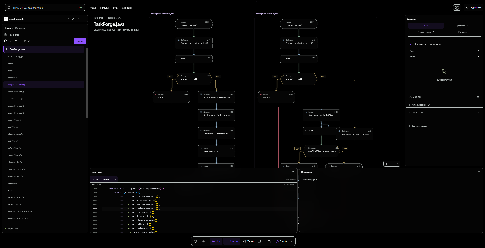
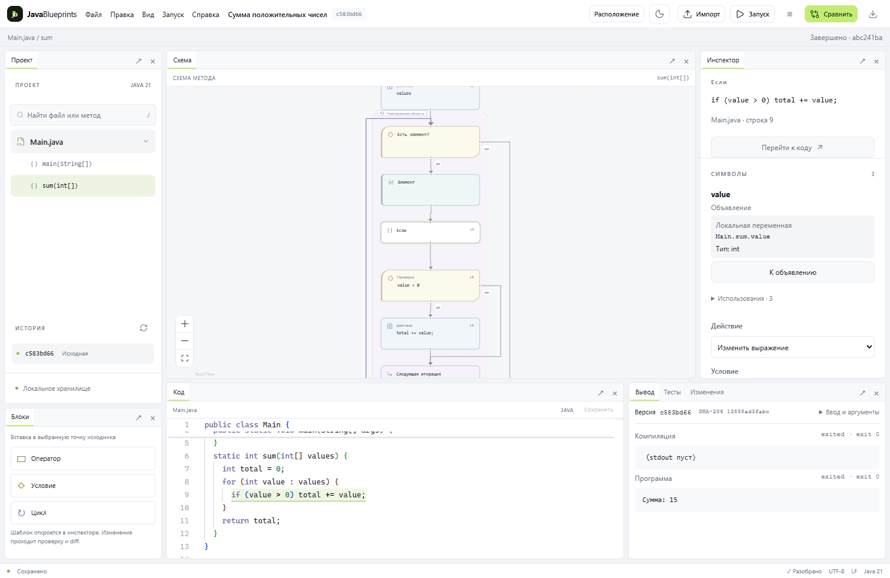
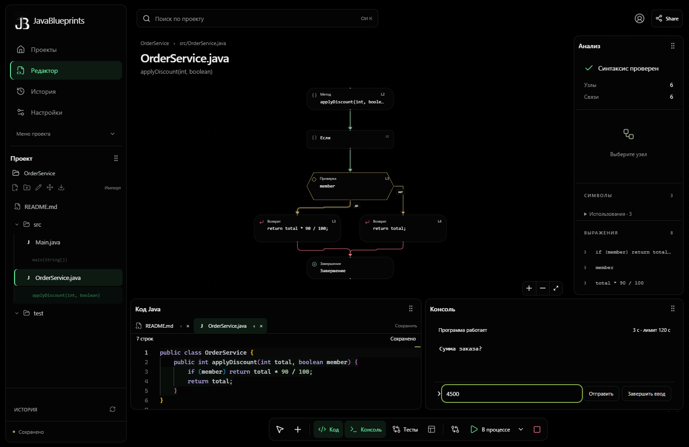
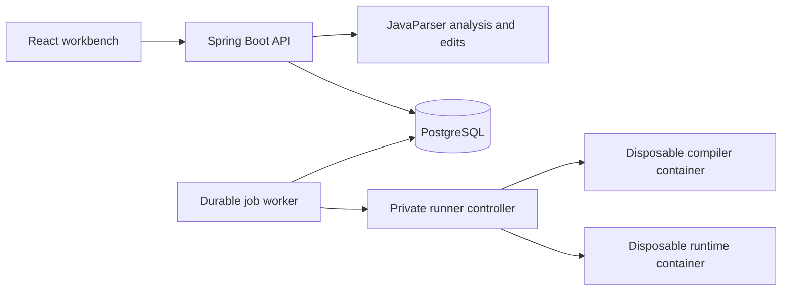

<div align="center">


# JavaBlueprints

**Read the code. See the structure. Check the change.**

[Русский](README.md) · **English**

[](pom.xml)
[](apps/server/pom.xml)
[](apps/web/package.json)
[](apps/web/package.json)
[](apps/web/vite.config.ts)
[](infra/compose.yaml)
[](infra/runner/README.md)
[](https://github.com/Stepa-Karpik/hack2-axenix-/actions/workflows/checks.yml)

[Open the application](https://java-blueprints.karpovprod.ru) · [Quick start](#start) · [Architecture](#architecture) · [Checks](#checks) · [Scope and limits](#current-scope)

</div>

JavaBlueprints is a Java 21 workbench that connects source code, a control-flow graph and reproducible checks. Explore a method, navigate to declarations, prepare a compiled change and compare immutable revisions in isolated containers before applying it.



| Explore | Change | Verify | Keep context |
| --- | --- | --- | --- |
| Source-linked method graphs and bounded symbol resolution | Typed edits, statement operations, extraction and local rename | Compile candidates; compare exact revisions on recorded inputs | Persistent panels, drafts, history, profiles and GitHub imports |

## Contents

- [Workflow](#workflow) and [workspace](#workspace)
- [Files and folders](#files-and-folders), [exception flow](#exception-flow), [console](#console) and [test inputs](#test-inputs)
- [Code insights](#code-insights), [accounts and access](#accounts-and-access), [GitHub](#github-integration) and [avatars](#profile-photos)
- [Membership index](#membership-index), [refactoring](#extract-and-reorganize-code) and [project archives](#project-archives)
- [Architecture](#architecture), [requirements](#requirements), [Windows start](#start) and [Linux start](#native-linux)
- [Checks](#checks), [API](#data-and-api), [hosting](#hosted-deployment-and-delivery), [execution limits](#fixed-execution-limits) and [current scope](#current-scope)

## Preview

| Light | Dark |
| --- | --- |
|  |  |

## Workflow

1. Open the landing page at `/`, then enter `/projects` and sign in or register. Create a project, then create files and folders or import text files from a ZIP archive, directory or connected GitHub repository. Review the file selection before adding it to the project. GitHub permissions are configured under Settings → Integrations.
2. Edit the source. Drafts persist locally on each edit; the server saves and analyzes after an eight-second idle pause. **Ctrl+S** saves immediately without opening the browser's page-save dialog, including with a Russian keyboard layout. Unchanged saves do not add revisions. Selecting a graph node reveals its exact source range and supported edit fields. Place the editor cursor on a reference to inspect its binding and navigate to a declaration, including one in another project file.
   Compound conditions show the evaluation order of `&&`, `||` and `!`, including branches that skip the right operand. Select an individual test to inspect its source, or its enclosing condition to edit the whole expression.
   Traditional `switch` statements show selector evaluation, case selection, fallthrough and the destination of `break` or an enclosing loop's `continue`.
   Enhanced `for` loops show the source evaluated once, followed by element checks, binding and body repetition. Synthetic iteration steps do not expose source-edit controls.
3. Open the block palette with **+** in the dock, then drag a block onto a graph node: its upper half inserts before it, its lower half inserts after it. A provisional shape opens space in the diagram; nearby method groups move temporarily when needed. **Escape** cancels the preview without changing code or saved positions. Empty methods accept an insertion at their entry node. Double-click an editable block to open its inspector. Edit its Java statement or supported expression, reorder statements within a block, wrap one in `if` or `while`, or add and remove a supported `else` branch. The original head stays intact while the candidate compiles.
4. Review the diff. A semantic change can be applied explicitly after compilation. A change marked as preserving behavior additionally requires a matching comparison for the exact two revisions.
5. Run the saved program and answer it in the live Console. Send additional lines while it runs, close standard input with **EOF**, or stop execution from the dock. Compare immutable revisions using a versioned test suite. Use **Run again** (`Запустить снова`) to repeat the recorded revision and parameters, including the exact version pair and suite for comparisons. Interactive replies are entered again. Download an individual source file with its original name and extension, or a folder/project as ZIP. Reports have separate JSON and CSV downloads.
6. Restore a historical snapshot from the history panel. Restoration creates a new revision with its source revision recorded; previous revisions remain intact. Save or discard an unsaved draft before restoring.

A saved syntax error remains a valid draft. Its analysis reports the error; an older graph is never treated as synchronized with that draft. Graph layout is stored separately from program text.

The project list searches all stored names and loads older projects in pages. Search treats punctuation literally; switching queries cancels the previous list request. Opening or searching for a project does not change its source revisions.

## Workspace

The graph is a permanent canvas beneath translucent panels. The dark theme uses a black canvas and flat near-black surfaces with backdrop blur; the light theme uses the same layout with light surfaces. The compact bottom dock has its own reserved row and never overlaps the tiled windows.

- Drag a panel by its six-dot handle. Nearby windows animate into the preview arrangement before you release the pointer. Drop in the center to swap windows, or near an edge to split the area. Press **Escape** to cancel. The handle also opens a keyboard-accessible move menu.
- Resize separators with the pointer or arrow keys. Hide or maximize a window from its header. The dock toggles Code, Console and Tests; **Windows** (`Окна`) restores other panels and resets the arrangement.
- Hidden windows keep their original slot and split ratios. Reopening a window retains its live editor, caret, undo history and output. Layout, visibility, active tabs and maximized state are saved separately for each project in the current browser.
- Reload restores the workspace and saved drafts. Editor view state and the graph camera are stored locally; editor undo history lasts for the current project session. Narrow screens use a panel selector while retaining the desktop layout.
- The last prepared change is recovered after reload when its base still matches the clean project head. Only its identifier is stored locally; the diff, compilation status and comparison result come from the server. Hidden panels stay hidden. Apply and dismiss remain explicit, and an unsaved or conflicting source draft takes priority.
- **Ctrl+K** focuses project search: file contents, method names, expressions and semantic block names such as `условие` or `цикл`. Select a result or press Enter to reveal its source and graph node.
- The sole Run control is in the bottom dock, alongside its options and the stop action while a job is active. File, edit, view and export commands sit beside search; narrow screens collapse them into the project menu.
- History and navigation are independent tiles. Navigation can collapse to its header; both tools can be moved, resized, hidden and restored. Existing browser layouts migrate without resetting their saved geometry.
- The first signed-in visit offers a skippable guided introduction. Replay it from **Settings → Appearance**.

Workspace preferences are independent of program revisions and graph-node positions. Rearranging windows does not edit source, compile a program or create a revision. Reduced-motion preferences disable layout animation; browsers without backdrop filtering use solid panel backgrounds.

Each method remembers its pan, zoom and unambiguous manually moved nodes across source saves and reanalysis. Automatic nodes reflow around retained positions after structural edits. The graph displays its source revision; the Console identifies output from an older revision even while that run is still waiting for input.

Selecting a file opens a project-wide overview of all method graphs; selecting a method focuses its graph. The selected method has a purple dashed boundary. Ctrl/Meta-click or Shift-drag a marquee to select several blocks and move them together; hold Space to pan. Overview group positions and camera are saved atomically in the current browser; focused-method layouts use the versioned server layout API. Picking a block still selects its own file and analysis. The Console and Tests panels retain separate latest results for each launch file; switching tabs or reloading restores the corresponding results. Their file, launch class and source revision remain visible. The browser stores result IDs only and rechecks their immutable source binding through the API. An ambiguous launch class exposes its report separately without assigning it to the open file.

Profile, security, appearance, friends and integration settings have separate routes and persistent navigation. Profiles show public projects plus private projects the viewer is permitted to access, up to six owned pinned projects, mutual friends and a 365-day activity calendar. Activity records actual authenticated head changes; older unattributed history is not assigned retroactively, and hidden projects do not contribute visible activity. Seven appearance presets include OLED, neutral dark, light, pearl, blue, amber and slate, plus a validated custom palette. Appearance preferences are stored in the current browser and synchronize between its open tabs. Authentication always uses an isolated OLED palette, independently of the saved appearance. Private sections require sign-in; public profile and shared-project views remain readable without an account.

GitHub linking uses the stable provider ID, PKCE and one-use session-bound state. GitHub can also create an account: an available provider username is preserved, while a conflict opens a username selection step before sign-in. Accounts created through GitHub use GitHub exclusively; password login, password reset and unlinking their only identity are unavailable. Existing password accounts can still link or unlink GitHub. Connecting GitHub under Settings → Integrations requests repository access in the same OAuth flow and saves the identity and encrypted repository grant atomically. Anonymous GitHub login requests identity access only; repository access is connected explicitly from Integrations. Imports are pinned to an immutable commit. Missing OAuth configuration leaves local import available. Expiring repository tokens rotate through a persisted single-flight claim; routine rotation preserves the immutable repository grant. An interrupted or uncertain token exchange requires explicit reconnection. Live provider authorization must be validated after the app keys are configured.

Java compilation checks the complete source bundle. A compiler error in another file can prevent the selected program and all of its tests from starting; the diagnostic filename identifies the broken source, not the launch class.

**Share** opens project access settings and copies its URL. Owners can switch account projects between private and public access and grant friends viewer or editor roles. Collaborator presence and simultaneous collaborative editing are not implemented.

Graph nodes use distinct icons, shapes and restrained semantic colors. Connections inherit the source block's color: amber for conditions, violet for loops, red for returns, and blue for operations and calls. These colors describe the program structure; they are not a runtime execution trace. Sequential steps stay in a top-to-bottom lane; branches use separate ranks and saved manual positions remain unchanged. Conditions expose labeled true/false ports; loop regions follow the engine's ancestry. A loop outline is omitted when a manually arranged graph would visually enclose unrelated nodes. Rounded routes preserve the obstacle-aware polyline's topology and mark routes whose safe path could not be found; arbitrary diagrams are not guaranteed to be planar.

## Files and folders

The project explorer supports nested folders, empty directories, file creation, renaming and moving a file or an entire subtree. Enter a new file or folder name and press **Enter** or click elsewhere to create it; **Escape** cancels. Its icon follows the filename extension. Drag an item onto a folder, or use the move action to enter its destination. A path change does not rewrite Java packages, imports or class names; compilation reports any resulting Java errors. A mismatched public Java type offers an explicit filename correction.

Open files appear as tabs with language-specific icons and editor highlighting. Switching, closing and reopening tabs retains the current file's draft, selection and undo history during the project session. File operations save a complete snapshot together with pending text edits. Concurrent changes produce a conflict instead of replacing another saved version.

Select a file or folder and use the trash action to delete it after confirmation. Folder deletion includes its subtree and retains other unsaved files in the new snapshot. Cancellation or a revision conflict preserves the current draft and tabs. Previous snapshots remain recoverable through history.

Import previews support strict UTF-8 text and ZIP archives, with selection before commit and no silent overwrite of existing paths. Archives preserve empty folders; a browser directory picker supplies files and their parent directories, but cannot enumerate empty folders. Unsupported binary files and unsafe or oversized archives are rejected. Build scripts from imported projects are never executed.

Non-Java text files can be edited and exported. Only `.java` files are analyzed and passed to the isolated Java runner. A project containing only text files or folders can be saved without scheduling a Java analysis or execution.

## Exception flow

Ordinary `try`, ordered `catch` clauses, multi-catch and `finally` are shown as executable control flow. Handler tests match the pending exception in source order. A throw from a handler or cleanup bypasses the sibling catches of that same `try`.

Cleanup has a separate continuation for normal completion, return, exception, break and continue. A return expression is evaluated before cleanup; an abrupt completion inside `finally` replaces the pending completion. Nested cleanup runs from the inside out, while a loop or switch jump that stays inside the `try` does not prematurely execute its finalizer. Separate copies of finalizer paths prevent impossible connections between unrelated completions; each copy navigates to the same original source.

Try-with-resources evaluates resource initializers or captured variable references from left to right and closes acquired resources in reverse order. Null resources skip closing; failed initialization closes only the acquired prefix. A close failure replaces a pending normal return or jump. When an exception is already pending, later close failures pass to `addSuppressed` in cleanup order. The graph shows self-suppression and failures of the suppression call; normal completion preserves the primary exception even when suppression is disabled. Associated catches and explicit `finally` run after resource cleanup. Generated cleanup nodes are read-only; initializer nodes navigate to the original source.

Calls and other expressions remain atomic. In methods containing `try`, dashed exceptional edges conservatively show possible failures, including unboxing, `close` and `addSuppressed`; they do not infer a unique runtime exception type or expand resource implementations. Edge metadata records certainty, reason and completion context. Expansion is bounded to 64 resources per `try`, 8192 flow nodes and 24576 edges per method; exceeding a limit preserves the method as read-only opaque source.

## Console

The Console displays standard output and errors during execution. **Send** delivers one line to the running program; **End input** (`Завершить ввод`, EOF) closes its input, allowing programs using `Scanner.hasNextLine()` or `readAllBytes()` to finish. The stop action retains captured output in the run report. Hiding the Console keeps the run active, and reloading its URL reconnects to the current job.

Interactive runs have a 120-second runtime limit, a 1 MiB combined output limit and a 1 MiB input budget including initial input. Each submitted input frame is limited to 8 KiB, with at most 1,024 frames. Compilation remains limited to 20 seconds. The elapsed time includes compilation and execution setup. Repeated input requests with the same idempotency key and body are delivered once.

The report records the immutable revision, initial input, accepted interactive input, arguments, output and termination status. New completed executions also record command wall time and, when available, the kernel cgroup peak memory for that disposable container. Time includes Docker exec and stream draining; peak memory includes container preparation and the measurement probe, and is not Java heap usage. Older reports and unavailable measurements retain an absent value rather than a fabricated zero. Comparison tests use fixed input and independent five-second executions; they do not accept live input. A server or controller restart interrupts a live session; its process cannot be resumed.

## Test inputs

Run and comparison dialogs check the selected snapshots for known public-type/filename mismatches before submitting a job. Open the reported file to rename it explicitly; existing files are never overwritten. Compilation remains authoritative for other Java errors. Failed comparison reports retain their original diagnostics and provide source navigation and a retry action; editing the project does not rewrite an old result.

The launch-class suggestion follows the open Java file. Without a prepared change, the original snapshot is suggested when its loaded sources have a matching launch hint; otherwise the current revision is used on both sides. Add expected outputs to check its results, or select distinct snapshots to compare behavior between versions. The original revision remains selectable outside the recent history page.

The comparison dialog opens with a form editor. Add, name or remove cases, enter standard input, and add arguments as separate strings. An empty argument remains a real argument. Enable expected stdout, stderr or an exit code when a case has a known result; an enabled empty output expectation checks for exactly empty output.

The optional JSON mode retains case IDs, Unicode, whitespace, argument values and supported metadata when switching views. Invalid drafts and input limits are reported before submission. Fields freeze while the request is sent, so the created immutable suite uses the reviewed values. The dialog keeps its action buttons visible on narrow screens while the case fields scroll.

## Test progress

The Tests panel shows compilation stages, the active case, completed and matched counts, and measured time for each case. Each case compares three independent executions of each revision. Cases run sequentially; the completion bar advances when their planned observations finish. Completion and a matching verdict are separate results.

Progress records the exact source revisions and suite version. Reloading reconnects to the same job; hiding its panel keeps verification running. Stopping retains completed case verdicts and partial observation counts, while remaining cases are marked unrun. An interrupted comparison does not publish a verification report that could authorize applying a change.

Per-case time includes all six executions and their container setup. Total time also includes compilation. The worker has a ten-minute overall job budget in addition to individual execution limits; an unfinished suite remains inconclusive. Progress is persisted under the current job attempt and lease. A restart can retain recorded progress, but cannot resume the interrupted executions.

## Code insights

The Analysis panel separates node editing, parser/coverage problems, recommendations and method metrics. Selecting a graph block opens its editor. Metrics follow the chosen method; recommendation headings navigate to their bound source location. Unsaved changes disable navigation through the older analysis.

Metrics include physical and code-token body lines, statement nodes, control nesting, loops and call sites. Nested declaration and lambda bodies are excluded from the enclosing method. The branching score is syntactic: one plus `if`, loops, conditional expressions, short-circuit operators, non-default switch groups and catch clauses. It is neither a complete CFG complexity measure nor a runtime estimate. Metric labels expose their definitions in tooltips.

Recommendations flag methods with at least 40 code-token lines, nesting of at least four control structures, nested loops, or a branching score of at least ten. They show the observed count, threshold, source location and a suggested review step. At most 400 findings are returned per analysis. These heuristics do not prove a defect, authorize a refactor or predict a speedup. Asymptotic time remains unknown until bounds and call costs can be established.

## Accounts and access

Register with a username, email and a password of 12–256 characters. Sign in with the username or email. Profile settings save the display name, biography and uploaded avatar on the server; public profiles list public account projects. Friends can exchange and accept requests. Project owners can grant an existing friend viewer or editor access, change that role, or remove it. Private is the default for new account projects.

Viewers can browse source, navigate the prepared graph and download snapshots. Read access includes the project's revision history, reports and artifacts. Editing, analysis creation, execution, restoration and persistent graph changes require owner or editor permission. Changing visibility or membership requires the owner. Public projects have the same read-only access without sign-in. The server checks project access before revisions, imports, exports, artifacts and jobs are accessed. Friendships and project roles are separate: revoke a previously granted project role in **Share** when it should end.

Earlier projects stay in the explicitly labeled local workspace. They are never assigned to the first registered account. Signed-in users can select **Local workspace** to reach them; this compatibility space remains editable on this local server. It is separate from private account projects.

**My projects** lists projects you own or have been invited to. Other public projects remain accessible through their author's profile or a direct link; publishing a project does not add it to everyone's personal list.

Email confirmation and password recovery use expiring, single-use links. Passwords are salted and derived with PBKDF2; only token hashes are stored. Password changes and resets revoke previous sessions and pending links. Without SMTP configuration, account work remains available and the interface reports that email delivery is unavailable. Real delivery requires the mailbox settings below.

## GitHub integration

There are two distinct entry points:

| Action | OAuth scope | Result |
| --- | --- | --- |
| Sign in with GitHub | Identity only; empty requested scope | Sign in to the linked account, or create a GitHub-only account |
| Connect GitHub in Settings → Integrations | `repo` | Link the stable GitHub identity and save an encrypted repository grant in one transaction |
| Reconnect an older identity-only link | `repo` | Add or renew repository access for the same provider identity |

An available GitHub username is retained, including hyphens and names up to 39 characters. A case-insensitive collision opens `/github/complete`; selecting another valid username finishes signup. The completion claim is session-bound, expires after ten minutes and is consumed once. Provider email is never used to merge accounts. GitHub-created accounts have no local password or email credential: password login, password reset, password changes and unlinking their only identity are blocked. Existing password accounts retain their password sign-in and can link or unlink GitHub.

Linking validates the returned `repo` scope before saving. If consent is denied or the scope is absent, a new link and grant are not created. Existing links and grants survive a failed reconnection. Repository tokens, including refresh tokens, are encrypted at rest with the server-only key. One-use state, PKCE, account locks and credential-version checks prevent a cancelled or stale callback from restoring access.

To configure an OAuth App, set the following in the private `.env`:

```dotenv
JB_GITHUB_CLIENT_ID=
JB_GITHUB_CLIENT_SECRET=
JB_GITHUB_TOKEN_KEY=
JB_GITHUB_CALLBACK_URL=http://127.0.0.1:5174/api/v1/github/oauth/callback
```

Use the exact callback URL in the provider's application settings. `JB_GITHUB_TOKEN_KEY` must be Base64 encoding of 32 random bytes and remain stable across restarts and deployments. Store it with other server credentials; changing it prevents decryption of existing grants. Missing configuration disables GitHub integration while local imports remain usable. The provider still displays its authorization screen; organization restrictions and revoked access may require reconnection.

## Profile photos

Upload a PNG or JPEG of at most **2 MiB** in profile settings, or remove it to restore the initials fallback. The server inspects image data rather than trusting the filename or MIME type, checks dimensions before decoding, crops the center square and re-encodes PNG at up to **512 × 512** without upscaling. Inputs are limited to 4096 pixels per side and eight million pixels. Normalized image bytes persist in PostgreSQL; versioned public avatar URLs use ETag validation.

## Membership index

For eligible repeated `ArrayList<String>.contains` searches, Analysis → Recommendations offers a membership-index change. It retains the original list and inserts one local `HashSet<String>` before the selected loop. Only the proven membership receivers inside that loop change; query evaluation, output order and list construction stay in place.

The initial rule accepts a fresh standard JDK list declared directly in the method body, populated only by standalone literal-string or null additions before a direct loop. Every use must have an exact local binding. Aliases, escaping references, reassignment, later mutation, other list operations, unknown query types, closures and unsupported control-flow regions make the rule unavailable. Queries are string/null literals or simple bound string locals/parameters. Analysis examines at most 64 loop candidates.

Open the change to review its assumptions, prepare the compiled diff, compare both immutable revisions on independent cases, and apply explicitly. This operation requires **Preserve behavior**; it cannot be applied as an unchecked semantic edit. Empty collections, nulls, duplicates, string hash collisions and query order are covered by the real-runner regression suite.

The index needs additional memory. Its effect on time and resource exhaustion is not proven, and no benchmark speedup is claimed. A matching report covers its recorded inputs and environment. General collection optimization remains outside the implemented scope.

## Extract and reorganize code

Select complete adjacent statements in **Code Java** to open **Extract method** in Analysis, or select a supported statement on the graph and choose the last statement in the inspector. Enter a new method name and prepare the change. The diff shows inferred parameters, the return type and the caller's replacement. The original project stays unchanged while the candidate compiles. Choose **Check on tests**, enter independent expected results, review the comparison, then apply explicitly. Compilation alone cannot authorize extraction.

Extraction moves at most 256 statements from one block into a private method in the same class. It retains static or instance context, passes required locals and parameters, and returns at most one local value or a selected method-tail return. Writes used on later loop iterations are assigned back to the caller. Checked exceptions are retained in the helper's declaration. Escaping jumps, multiple live output variables, ambiguous bindings, unsupported captures and caller-observed exceptional local writes are refused. Local constant variables whose compile-time evaluation could change are also refused. Stack frames and timing can change after any method extraction; matching tests cover the recorded observations, not universal equivalence.

**Rename local variable** changes the selected single-variable declaration and its exact bound references. A method entry can rename its sole parameter. Other overloads and same-named fields stay unchanged. Name collisions, possible capture and unresolved references are refused. This operation uses the same compiled-candidate and comparison gate.

For a closed static computation, select its entry and choose **Move method to class**. The original method remains as a wrapper while its body moves to a new fieldless class in the same package. The initial rule accepts explicit `int`/`boolean` parameters, locals and results with supported branches and loops. Calls, fields, arrays, inheritance, generics and unknown dependencies make the rule unavailable. Review both files and compare behavior before applying; this is a bounded decomposition tool.

## Project archives

**Project menu → File → Download project archive** saves a versioned `.jbp.json` archive containing source history, original import bytes, directory trees, historical analyses, layouts, suites and completed reports, with SHA-256 integrity checks. **Open project archive** validates it and creates a separate project with fresh revision IDs. Existing projects are never replaced.

Imported reports and layouts remain historical evidence in the import receipt. They do not become current verification or editable graph bindings. The head receives a fresh analysis; run a fresh comparison before applying further preserving changes. Source ZIP export remains available for ordinary Java tools. Archives are bounded to 64 revisions and 32 MiB, with explicit evidence/layout limits; over-limit archives are rejected rather than truncated. Credential-like paths are rejected, but source text and recorded inputs can contain sensitive information, so review an archive before sharing it.

## Architecture



| Component | Location | Responsibility |
| --- | --- | --- |
| Web | `apps/web` | Standalone landing page, account screens, configurable panel workspace, Monaco editor, React Flow graph, proposals and reports |
| API | `apps/server` | Account sessions, profiles, friends, project access, revision history, CAS, artifacts and durable jobs |
| Program engine | `modules/program-engine` | Parsing, source/JDK symbol resolution, graph construction and typed edits |
| Verification | `modules/verification` | Runner protocol and repeated comparison |
| Runner controller | `apps/runner-controller` | Bounded compiler/runtime containers and cleanup |
| Deployment | `infra` | Pinned base images and Compose networks |

Java source is never compiled or executed by the API JVM. Only the trusted controller receives the Docker socket. Compiler and runtime containers have no network, no host mounts, a read-only root, a non-root user, dropped capabilities and enforced resource limits.

The root `/` always serves the standalone landing page, whether signed in or not. `/projects` opens the account project list; anonymous visitors continue through sign-in. `/login`, `/register`, `/github/complete`, settings, public profiles and project URLs keep their own application routes. The landing page uses local fonts, images and Three.js assets, independently of the workbench stylesheet.

### Stack

| Layer | Technology |
| --- | --- |
| Browser | React 19.3.1, TypeScript 5.9.3, Vite 8.3.5, Monaco 0.57, React Flow 12.12 |
| Server | Java 21, Spring Boot 4.0.9, JDBC, Flyway |
| Analysis | JavaParser 3.28.2, in-memory source bundle and bounded JDK symbol resolution |
| Persistence | PostgreSQL 17; source snapshots, jobs, reports, accounts, avatars and encrypted grants |
| Execution | Linux Docker Engine, disposable Java 21 compilation/runtime containers |
| Tooling | Maven Wrapper 3.9.16, Node.js 24, pnpm 11.25.0, JUnit, Playwright, GitHub Actions |

## Requirements

- JDK 21; Maven 3.9.16 is provided through the checksum-pinned Maven Wrapper.
- Node.js 24 and pnpm 11.25.0 on `PATH`, or portable directories configured with `JB_NODE_HOME` and `JB_PNPM_HOME` in `.env`.
- Windows PowerShell 7 and a WSL2 distribution named `JavaBlueprints`, with Docker Engine and Compose installed and running inside that distribution.
- Access to Maven Central, the pnpm registry and the pinned container images on the first build.

The supplied Windows launcher uses the dedicated `JavaBlueprints` distribution. It does not change the system `PATH`, other WSL distributions or global networking settings. Caches are kept under the repository's ignored `.local` directory. On Linux, the same Maven/pnpm builds and `infra/compose.yaml` can be used with a native Docker Engine.

## Configuration

The working `.env` is private and ignored by Git. The public [`.env.example`](.env.example) contains placeholders. Keep server secrets out of `VITE_*`, browser bundles and version control.

| Variables | Purpose |
| --- | --- |
| `JB_BIND_HOST`, `JB_API_PORT` | Native API bind address and port |
| `JB_DB_HOST`, `JB_DB_PORT`, `JB_DB_NAME`, `JB_DB_USER`, `JB_DB_PASSWORD` | PostgreSQL connection |
| `JB_ALLOWED_ORIGINS`, `JB_PUBLIC_URL` | Allowed browser origins and canonical application URL |
| `JB_RUNNER_ENABLED`, `JB_RUNNER_CONTROLLER_URL`, `JB_RUNNER_CONTROLLER_TOKEN` | Trusted Linux execution service; Compose supplies its private URL |
| `JB_SMTP_*` | Email verification and password recovery |
| `JB_GITHUB_*` | OAuth App and repository grant encryption key |
| `JB_HOSTING_ENABLED`, `JB_SESSION_COOKIE_SECURE` | Explicit hosted mode and Secure session cookies |

## Start

From the repository root:

```powershell
./scripts/start.ps1
```

The launcher creates `.env` from `.env.example` when needed, generates missing local database and controller secrets, builds Java and the frontend, starts Compose, and waits for HTTP readiness. Open **http://127.0.0.1:5174**. The terminal reports whether the isolated runner is available.

The workbench and API share one origin. PostgreSQL is bound to `127.0.0.1:55433`; the runner has no published port and is reachable only on its private control network. Stop the services while retaining database data:

```powershell
./scripts/stop.ps1
```

After a successful build, `./scripts/start.ps1 -SkipBuild` reuses the generated application artifacts and rebuilds their container images. Do not run the Vite development server and the Compose workbench on port 5174 at the same time.

### Email configuration

Set these fields in the ignored `.env`, then restart the stack:

```dotenv
JB_SMTP_HOST=smtp.yandex.ru
JB_SMTP_PORT=465
JB_SMTP_USERNAME=
JB_SMTP_PASSWORD=
JB_SMTP_FROM=
JB_PUBLIC_URL=http://127.0.0.1:5174
```

Use the full mailbox address for username and sender, and a Yandex application password for `JB_SMTP_PASSWORD`. SMTP uses implicit TLS with certificate and hostname verification. Follow [Yandex's mail-client setup](https://yandex.ru/support/yandex-360/customers/mail/ru/mail-clients/others.html). `JB_PUBLIC_URL` supplies the origin of confirmation and reset links. Keep mailbox credentials out of frontend variables and Git. Verification links expire after 24 hours; reset links expire after one hour. SMTP transport and delivery errors are reported explicitly; local tests do not claim real Yandex delivery.

To use a native API process during frontend development:

```powershell
./scripts/start-server.ps1 -Build
# In another terminal with Node/pnpm configured:
pnpm dev
```

The native API binds to `127.0.0.1:8081`. Start the database first with Compose. Native execution features remain unavailable unless a trusted Linux runner URL and token are explicitly configured; the application never falls back to host execution.

## Native Linux

With JDK 21, Node 24, pnpm 11.25.0, Docker Engine, Compose and curl installed:

```bash
bash scripts/start.sh
# Open http://127.0.0.1:5174
```

The script creates local secrets, builds from the checked-in dependency versions and starts the same Compose stack. Java and frontend checks can be run separately:

```bash
# Export the private database values for the native integration test process.
set -a; source .env; set +a
docker compose --env-file .env -f infra/compose.yaml up -d db
MAVEN_USER_HOME="$PWD/.local/cache/maven-wrapper" bash ./mvnw -B -ntp test
pnpm typecheck && pnpm test:web && pnpm build
```

The Windows launcher and test command are verified in the prepared Windows/WSL environment. The native Linux launcher uses the same build and Compose commands; a separate clean Linux-host run has not yet been validated.

## Checks

```powershell
./scripts/test.ps1
pnpm typecheck
pnpm test:web
pnpm build
```

The Java command runs parser/graph/edit tests, semantic binding tests, comparison tests and real PostgreSQL HTTP integration tests. Each backend integration run creates its own randomly named schema and removes that schema afterward. It checks lexical scope and shadowing, bounded overload resolution, source/JDK targets, analysis environment invalidation, structural edit anchors and source preservation, concurrent head updates, idempotent restoration and replay, immutable storage, invalid drafts, strict import normalization, original artifact bytes, ZIP export content, scoped IDs, CSRF/origin checks, layout bindings and fenced job publication.

Docker execution integration tests are opt-in through `JB_RUNNER_INTEGRATION=true` and require a Linux controller. A Windows API/client can call that controller over authenticated HTTP; the controller's Docker subprocesses must run on Linux. Tests cover actual compilation, exact UTF-8 streams, three observations per side, intentional mismatches, compilation errors, timeout, output limits, cancellation and sandbox boundaries. Ordinary `test.ps1` does not claim to run those opt-in checks. See [the runner integration commands](infra/runner/README.md#repeat-the-execution-integration-checks) for the complete controller setup and invocation.

To repeat the browser checks, start the complete stack first, then install Chromium and run Playwright:

```powershell
$env:PLAYWRIGHT_BROWSERS_PATH="$PWD/.local/cache/playwright"
pnpm --filter @java-blueprints/web exec playwright install chromium
pnpm --filter @java-blueprints/web exec playwright test
```

These browser tests create synthetic projects in the local database. They exercise session recovery, concurrent edits, source bindings, declaration navigation across files, stale semantic bindings, invalid drafts, responsive light/dark layouts, structural insert/delete proposals, historical restoration and actual candidate verification.

Synthetic account browser tests require SMTP delivery to be disabled and skip when a live mailbox is configured. Server account tests use a mocked mail transport.

Workspace checks cover drag-and-drop arrangements, tab groups, resizing, local preference recovery and preservation of editor and graph state. Pure frontend tests validate layout-tree invariants and graph presentation geometry. UI layout actions must not create source revisions, proposals, jobs or graph-layout writes.

### Large project fixture

The versioned example in [fixtures/synthetic/large](fixtures/synthetic/large) contains 1100 source lines, ten classes and fifty methods. Import that directory, choose `demo.Main`, and provide a count followed by that many integers on standard input. The browser check imports the complete ZIP, verifies every source hash, navigates across files, exports the unchanged snapshot, and compares a compiled candidate on twenty deterministic inputs with independent expected output and three observations per side.

```powershell
pnpm --filter @java-blueprints/web exec playwright test tests/largeProject.spec.ts
./mvnw.cmd -B -ntp -pl modules/program-engine '-Djb.engine.perf=true' '-Dtest=EnginePerformanceTest' test
```

The optional engine benchmark parses and analyzes the fixture without compiling or executing its Java code on the host. It writes `modules/program-engine/target/engine-benchmark.json`: the first analysis in a fresh test JVM, five warmups, thirty warm samples, median, p95, maximum and the exact bundle hash. These measurements cover source analysis. Program execution remains isolated in Docker; browser timings include their stated automation and rendering overhead. This fixture does not establish complete Java language coverage or a performance guarantee.

## Data and API

The API lives under `/api/v1`. `GET /session` establishes a local cookie and returns a session-bound CSRF token. Mutations require the token and an allowed `Origin`; project mutation endpoints also use an idempotency UUID. Head mutations require `If-Match` with the current revision UUID, or `empty` for a project without a head. A concurrent change returns a conflict instead of overwriting another save.

`GET /projects` accepts `limit` (default 20, maximum 100), optional `q` (literal case-insensitive name substring, maximum 120 characters), and optional `before` (an existing project UUID). Pages use descending creation time with UUID as the stable tie-breaker; the next cursor is the last displayed project. The response keeps its project array shape.

Revisions retain canonical UTF-8 text with LF line endings, directory entries and a SHA-256 tree hash. The separate bundle hash covers the Java subset and is absent when there are no Java sources. Imports also retain original bytes and normalization metadata. Analyses carry their own version and source-map identity; node IDs are valid only in that analysis. Candidates, suites and reports retain their exact input references. Artifacts are retrieved by project-scoped IDs rather than host paths.

Graph nodes advertise `allowedOperations` and `insertionPositions`. The change endpoint accepts `replace_expression`, `replace_statement`, `insert_statement`, `delete_statement`, `move_statement`, `wrap_if`, `wrap_while`, `add_else`, `remove_else` and the restricted `optimize_membership` operation with operation-specific payloads. Insertions and structural edits use bound statements or method entries, never client-supplied source offsets. Membership indexing uses an empty payload and requires preservation intent. Compilation validates the complete candidate before it becomes applicable. `POST /projects/{p}/revisions/{r}/restore` creates a new revision with `sourceRevisionId`, checks the current head, and starts a fresh analysis. Restoration does not inherit a previous revision's verification result.

The same change endpoint accepts `extract_method` with `{methodName,endNodeId}`, `decompose_class` with `{className}`, and `rename_local` with `{newName}`. These commands require `preserve_behavior` and an exact current node binding. They cannot accept raw source offsets or bypass the comparison gate. Project archives use `POST /projects/{p}/archives`; `POST /archive-previews` validates a file before creating a destination, and `POST /projects/{p}/archive-imports` requires an empty target and `If-Match: empty`.

Analyses include a `semantics` model with analysis-scoped symbols and references, plus a `symbolEnvironmentHash` identifying the resolver configuration and JDK runtime. Source targets carry declaration-name ranges; JDK targets carry external keys without fabricated source locations. Each reference records an exact compile-time target, bounded candidates, or an unresolved reason. Virtual calls do not claim a unique runtime target. Updating the engine or resolver environment requires a fresh analysis for new edits; historical analysis and accepted idempotent responses remain readable.

Graph nodes carry an `executionRole` that distinguishes statements and condition tests from structural anchors, source expression projections and synthetic flow nodes. Short-circuit tests have source ranges but do not add edit operations. Enclosing condition anchors retain their existing edit controls. Older analyses without this field retain an unknown role.

A comparison means **matched on the recorded tests**, not a proof of equivalence. It requires a nonempty suite, complete observations and stable exact stdout/stderr/exit results. Equal timeouts, OOM, truncated output, cancellation or unavailable execution never count as a match. A standalone run does not satisfy the verification gate for a behavior-preserving change.

## Hosted deployment and delivery

The hosted workbench uses **https://java-blueprints.karpovprod.ru**. Development and hosting have separate databases and Docker engines.

`infra/compose.production.yaml` runs the API, PostgreSQL and private runner in a dedicated rootless Docker engine. Only the API is published, on loopback port 18684 behind the HTTPS proxy. PostgreSQL and the controller have no public ports. The controller receives only that dedicated engine's socket; the web application and Java sandboxes receive no Docker socket. Per-container limits operate under the application user's aggregate cgroup limits.

Hosting requires `JB_HOSTING_ENABLED=true`, `JB_SESSION_COOKIE_SECURE=true` and the canonical `JB_PUBLIC_URL`. The proxy must replace client forwarding headers, and Tomcat must trust only its actual internal proxy peers. Keep session cookies HttpOnly and SameSite=Lax. Public project source remains readable; creating projects, running programs and materializing ZIP/archive exports require an authenticated account and the appropriate project role. Exact source-file downloads are read operations.

GitHub uses server-only `JB_GITHUB_CLIENT_ID`, `JB_GITHUB_CLIENT_SECRET`, `JB_GITHUB_TOKEN_KEY` and `JB_GITHUB_CALLBACK_URL`. The production callback is `https://java-blueprints.karpovprod.ru/api/v1/github/oauth/callback`. The encryption key is Base64 of 32 random bytes and must persist across deployments. Provider consent, account linking and repository access remain explicit user actions; secrets never enter the frontend build.

The `checks` workflow builds and tests each revision. A successful push to this repository's `main` additionally builds commit-labeled images from those exact Java/frontend artifacts, uploads a checksummed release and deploys it through a dedicated restricted SSH key. Pull requests cannot deploy. The deployment is serialized, verifies the current main revision, pins the SSH host key, checks the image IDs and commit labels, and uses the owned rootless engine only. GitHub Actions stores the four `JB_DEPLOY_*` connection secrets; application credentials remain on the server.

`scripts/deploy-release.py` accepts only `status` and `deploy <commit> <checksum>`, rejects unsafe archive members, verifies the running image IDs, checks API/runner/hosted-policy readiness and public HTTPS assets, and publishes the current-release pointer after those checks. Subsequent deployments first save a database snapshot; a failed application update attempts to restore the previous images. A failed first deployment stops its API and runner while retaining the database. Database rollback is a separate operator action: schema changes must remain compatible with the previous release. The receiver retains the latest three release records plus an older current/previous release when needed, and ten database snapshots. It does not prune other applications or their Docker engine.

Deployment recreates this application's singleton services and can interrupt active executions. Schedule updates outside a live demonstration; uninterrupted job migration is not provided.

Deployment receiver tests run on Linux with `python3 -m unittest discover -s tests/deploy -v`. TLS setup, provider consent and actual hosted execution are separate deployment checks; unit tests do not establish them.

## Fixed execution limits

The `java21-v1` execution limits are fixed and cannot be changed through environment variables. Reports also retain the profile hash: changes to input delivery or measurement semantics produce a different hash, and an older report cannot verify a change in the new environment.

| Limit | Value |
| --- | --- |
| Project tree | 100 entries including directories, 1 MiB UTF-8 text |
| ZIP import | 1 MiB compressed input and 1 MiB total expanded content |
| Console input | 1 MiB |
| Arguments | 100, 8 KiB each, 64 KiB combined UTF-8; no NUL |
| Test suite | 100 cases; three independent runs per version and case |
| Sandbox | 512 MiB RAM, 1 CPU, 128 PIDs |
| Compilation / comparison runtime / interactive runtime | 20 seconds / 5 seconds / 120 seconds |
| Combined stdout and stderr | 1 MiB per execution |
| Controller retention | 1024 handles, 64 MiB aggregate, ten minutes |
| Backend job deadline | Ten minutes; incomplete work cannot verify preservation |

Java source paths and case identifiers follow the shared runner policy. Java paths use relative ASCII Java identifiers, with `package-info.java` and `module-info.java` also accepted. Other text paths may contain Unicode and spaces; all paths must be relative and cannot contain traversal components. A test case's separate display name may contain Unicode.

## Current scope

The implemented slice supports source import/save/history/restore, JavaParser-backed method graphs, source navigation, typed expression/condition replacement and statement insertion/deletion, separate layout persistence, detached proposals with diff and explicit apply, console runs, versioned console suites, repeated comparison and source export.

Structural edits are limited to supported methods and actual block statement lists. Reordering moves one statement before or after a sibling in the same block. Wrapping creates a braced `if` or `while` around one statement; a new loop cannot capture an existing outer `break` or `continue`. Adding `else` requires a braced `then` branch and a braced new body; removing `else` requires braced branches and a comment-free removal span. The inspector exposes only the operations available for the selected node.

These are explicit semantic edits: changed order or repetition can change program behavior. Compilation checks types, scope, definite assignment and reachability before apply; preservation still requires a matching recorded comparison. Internal comments move with the statement, while comments outside its token span remain at their original positions. Deletions cannot discard comments. Opaque constructs and expression fragments are not structural edit anchors. Cross-block moves, multi-statement wrapping and a general structural undo/redo stack remain outside this scope; historical restoration is explicit.

Condition flow covers normal completion of `&&`, `||`, `!` and parentheses in supported `if`, `while`, `do` and `for` conditions. Other expression subtrees remain atomic tests; calls, eager operators, ternaries and unboxing are not expanded into a complete expression or exception graph. Loop initialization, updates and unlabeled jump targets remain explicit. A method exceeding 4096 condition tests is preserved as opaque with a diagnostic.

Traditional colon-style `switch` statements evaluate the selector once and dispatch to a case or default, with explicit fallthrough and unlabeled jump targets. Selector and case nodes support source navigation; separate expression projections retain their existing edit controls. Case-label type and constant validity are checked by the isolated compiler. Direct case statement lists do not become insertion or deletion anchors; actual nested blocks retain those operations. The method-wide limits are 1024 switch entries and 4096 labels. Arrow rules, switch expressions, patterns, `case null` and labeled jumps remain outside this control-flow subset and preserve the method as opaque. In try-containing methods, a conservative selector-exception edge reaches the active handler; expression internals are not expanded.

Enhanced `for` uses a normal iteration abstraction for arrays and `Iterable`: a source expression is evaluated once, then synthetic check, element-binding and continuation steps surround the body. This does not expand the distinct array and iterator protocols, conversions or exceptional paths into individual Java operations. `break` and `continue` retain their enclosing-loop targets, including through nested switches. Existing expression projections support changing the source through the compile-gated proposal workflow; synthetic steps are read-only and have no invented source range. Methods exceeding 1024 enhanced loops are preserved as opaque with a diagnostic.

The graph/edit support matrix is intentionally conservative: unsupported constructs remain visible as limitations and are preserved in source. Symbol resolution covers a bounded subset of source classes/interfaces, fields, parameters, local variables, methods, constructors and platform JDK references. It uses only the in-memory source bundle and the platform classloader; application dependencies and filesystem classpaths are not searched. Local/anonymous classes, lambdas, unsupported type domains and unresolved dependencies can produce partial results. Overload inference is bounded. General access-control, alias, escape, effect and dominance analysis is not provided; the membership rule performs its own closed local checks. Analysis budgets can reject oversized or deeply nested ASTs while retaining the source.

Asymptotic complexity remains unknown. Renaming, extraction and class decomposition cover the explicit bounded rules above. General whole-project renaming, arbitrary dependency migration, optimization beyond the membership rule and method harnesses remain outside this scope. A resolved reference does not establish that a program compiles or preserves behavior. External build dependencies are not imported; the runner compiles a bounded Java 21 source bundle against its fixed JDK.

The default development deployment remains bound to localhost. The explicit hosted mode requires a canonical HTTPS origin and Secure cookies, disables the legacy guest workspace and anonymous project creation, and retains permission-filtered public reads. Account sessions and project permissions remain enforced on every project operation. The runner controller is a singleton; its execution handles are bounded and temporary, while completed reports and artifacts are persisted by the API. Controller restart makes in-flight handles unavailable. Full mandatory-language coverage, public deployment hardening and broad performance claims require further validation.
