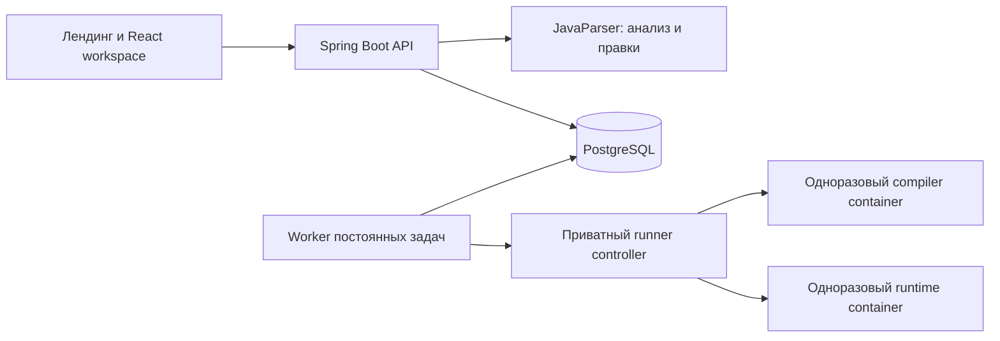

<div align="center">


# JavaBlueprints

**Читайте код. Исследуйте структуру. Проверяйте изменения.**

**Русский** · [English](README.en.md)

[](pom.xml)
[](apps/server/pom.xml)
[](apps/web/package.json)
[](apps/web/package.json)
[](apps/web/vite.config.ts)
[](infra/compose.yaml)
[](infra/runner/README.md)
[](https://github.com/Stepa-Karpik/hack2-axenix-/actions/workflows/checks.yml)

[Открыть приложение](https://java-blueprints.karpovprod.ru) · [Запуск](#быстрый-запуск) · [Архитектура](#архитектура) · [Тестирование](#тестирование) · [Ограничения](#границы-возможностей)

</div>

JavaBlueprints — рабочая среда для Java 21, которая связывает исходный код, граф потока управления и воспроизводимые проверки. Исследуйте метод, переходите к объявлениям, готовьте изменения с проверкой компиляции и сравнивайте неизменяемые версии в изолированных контейнерах перед применением.


| Исследовать | Изменять | Проверять | Сохранять контекст |
| --- | --- | --- | --- |
| Графы методов с привязкой к коду и разрешением символов | Выражения, блоки, извлечение метода и локальное переименование | Компиляция кандидата и сравнение точных версий на выбранных входах | Панели, черновики, история, профили и импорт из GitHub |

## Содержание

- [Сценарий работы](#сценарий-работы) и [рабочее пространство](#рабочее-пространство)
- [Файлы и импорт](#файлы-и-импорт), [граф и исключения](#граф-и-исключения), [консоль и тесты](#консоль-и-тестовые-наборы)
- [Анализ и рефакторинг](#анализ-и-рефакторинг), [архивы проектов](#архивы-проектов)
- [Аккаунты](#аккаунты-и-доступ), [GitHub](#интеграция-с-github), [фотография профиля](#фотография-профиля)
- [Архитектура](#архитектура), [запуск](#быстрый-запуск), [конфигурация](#конфигурация)
- [Тестирование](#тестирование), [API](#api-и-данные), [развёртывание](#развёртывание-и-доставка)
- [Лимиты](#фиксированные-лимиты) и [границы возможностей](#границы-возможностей)

## Сценарий работы

1. Откройте главную страницу `/`, перейдите в `/projects` и войдите или зарегистрируйтесь. Создайте проект, добавьте файлы вручную либо импортируйте ZIP, каталог или выбранные файлы из GitHub. Перед добавлением проверьте состав импорта.
2. Редактируйте код. Черновик сохраняется в браузере при каждом изменении; через восемь секунд без ввода сервер сохраняет и анализирует текст. Кнопка **«Сохранить»** в редакторе сохраняет изменения в проекте немедленно. **Ctrl+S** скачивает активный файл с текущими изменениями, исходным именем и расширением, в том числе с русской раскладкой. Повторное сохранение того же текста не создаёт версию.
3. Выберите метод или узел графа. Узел показывает точный участок исходника и поддерживаемые операции. Поставьте курсор на ссылку в редакторе, чтобы проверить её привязку и перейти к объявлению, в том числе в другом файле.
4. Откройте палитру кнопкой **+** в нижней панели. Верхняя половина узла вставляет блок перед ним, нижняя — после. Предпросмотр временно освобождает место; **Escape** отменяет его без изменения кода и сохранённых позиций. В пустом методе вставка доступна у входного узла. Двойной щелчок открывает инспектор редактируемого блока.
5. Подготовьте изменение и изучите diff. Исходная версия остаётся прежней, пока кандидат компилируется. Семантическое изменение применяется явно после успешной компиляции; изменение с намерением **сохранить поведение** дополнительно требует совпавшего сравнения именно этих двух версий.
6. Запустите сохранённую программу, отвечайте через консоль или сравните версии на версионируемом наборе тестов. **Запустить снова** повторяет записанную версию и параметры, включая пару версий и набор сравнения. Ответы интерактивной сессии вводятся заново.
7. Скачайте файл с исходным именем, каталог или проект в ZIP. Отчёты доступны отдельно в JSON и CSV. Для возврата к истории сначала сохраните или отбросьте черновик: восстановление создаёт новую версию, сохраняя прежние.

Синтаксическая ошибка не уничтожает черновик. Анализ показывает ошибку, а предыдущий граф не выдаётся за синхронизированный с новым текстом. Раскладка графа хранится отдельно от исходного кода.

Список проектов ищет по всем сохранённым именам и загружает старые проекты страницами. Знаки пунктуации обрабатываются буквально; новый запрос отменяет предыдущий. Поиск и открытие не меняют версии.

Повторно пройти интерактивное знакомство можно кнопкой **«Обучение»** слева. В редакторе отдельный маршрут доступен через **«Справку»** и кнопку **«Обучение редактору»** в навигации.

## Рабочее пространство

На холсте **Ctrl+Z** отменяет перемещение блока или группы, **Ctrl+Shift+Z** повторяет его. Поддерживается русская раскладка. Применённую правку схемы также можно отменить и повторить: восстанавливается исходный текст новой версией, прежняя история сохраняется. В редакторе кода эти сочетания работают с его собственным текстом.

Граф служит постоянным холстом под полупрозрачными панелями. По умолчанию включён OLED: чистый чёрный холст и плоские почти чёрные поверхности с размытием фона. Другие темы согласованно меняют фон холста, страниц и шапки; светлые используют светлые поверхности. Для нижней панели выделена отдельная строка, поэтому она не перекрывает окна.

| Светлая тема | Тёмная тема |
| --- | --- |
|  |  |

- Перетаскивайте окно за ручку из шести точек. Центр меняет окна местами, край делит область. Соседи показывают будущую раскладку до отпускания указателя. **Escape** отменяет перенос; у ручки есть доступное с клавиатуры меню перемещения.
- Меняйте размеры разделителями или стрелками, скрывайте и разворачивайте окна. Нижняя панель переключает код, консоль и тесты; меню **Окна** возвращает остальные панели и сбрасывает раскладку. История и навигация — отдельные окна; навигация сворачивается до заголовка.
- Скрытая панель сохраняет место, пропорции, редактор, курсор, текущую историю отмены и вывод. Раскладка, вкладки и видимость сохраняются для каждого проекта в браузере. Старые раскладки мигрируют без сброса геометрии.
- Перезагрузка восстанавливает раскладку и черновики. Состояние редактора и камера графа хранятся локально; история отмены действует в текущей сессии проекта. На узком экране используется переключатель панелей с сохранением настольной раскладки.
- Последнее подготовленное изменение восстанавливается, если его база совпадает с чистой текущей версией. Браузер хранит только идентификатор; diff, компиляция и сравнение приходят с сервера. Применение и отклонение явные, а несохранённый или конфликтующий черновик имеет приоритет.
- **Ctrl+K** открывает поиск по тексту файлов, именам методов, выражениям и смысловым названиям блоков: например, `условие` или `цикл`. Результат открывает код и соответствующий узел.
- Запуск и остановка находятся в нижней панели. Файловые команды, редактирование, вид и экспорт расположены рядом с поиском; на узком экране они сворачиваются в меню проекта.
- При первом входе доступно обучение, которое можно пропустить и повторить в **Настройки → Оформление**. Системное уменьшение анимации отключает движения раскладки; без backdrop-filter панели получают сплошной фон.

Перестановка окон не создаёт версии, предложения изменений, задачи исполнения или серверные записи раскладки графа. Каждый метод отдельно запоминает масштаб, сдвиг и однозначно сопоставленные вручную перемещённые узлы. Автоматические узлы перестраиваются вокруг сохранённых позиций.

Файл открывает обзор графов всех методов; выбор метода фокусирует его граф с фиолетовой пунктирной границей. **Ctrl/Meta + щелчок** или рамка с **Shift** выбирает несколько блоков; **Space** перемещает холст. Обзорные позиции групп и камера атомарно сохраняются в браузере, позиции внутри метода — через версионируемый серверный API. Блок открывает собственный файл и анализ.

Консоль и тесты запоминают последние результаты отдельно для каждого запускаемого файла. После смены вкладок и перезагрузки видны файл, запускаемый класс и версия источника. Браузер хранит ID результатов и проверяет их неизменяемую привязку через API. Неоднозначный запускаемый класс оставляет отчёт отдельно, без назначения открытому файлу. Устаревший относительно редактора вывод явно обозначается.

Большие схемы используют виртуализацию и облегчённую отрисовку общего вида: все логические узлы и связи сохраняются, а подробные карточки возвращаются при приближении. Цвета переходов, пунктир консервативных связей, выделение и ручные позиции сохраняют своё значение. Редактор кода загружается отдельно от страниц входа и профиля; открытие проекта не ждёт загрузки истории версий.

## Файлы и импорт

Проводник поддерживает вложенные и пустые каталоги, создание, переименование и перенос файлов или поддеревьев. **Enter** или щелчок вне поля подтверждает имя, **Escape** отменяет создание. Значок и подсветка зависят от расширения. Для переноса перетащите элемент на каталог либо введите целевой путь через соответствующую команду.

Смена пути не переписывает `package`, импорты и имена классов: последствия проверяет compiler. Несовпадение имени публичного Java-типа и файла допускает явное исправление имени без перезаписи существующего файла.

Вкладки сохраняют черновик, выделение и историю отмены в текущей сессии. Файловые операции сохраняют полный снимок вместе с ожидающими правками текста. Конкурирующие изменения возвращают конфликт вместо перезаписи чужой версии. Удаление файла или каталога требует подтверждения, сохраняет прочие несохранённые файлы и не уничтожает историю. Отмена и конфликт оставляют черновик и вкладки.

Предпросмотр принимает строгий UTF-8 и ZIP, позволяет выбрать пути и не перезаписывает существующие файлы молча. ZIP сохраняет пустые каталоги; браузерный выбор каталога передаёт файлы и родительские пути, но не перечисляет пустые папки. Неподдерживаемые бинарные файлы, опасные и слишком большие архивы отклоняются. Скрипты сборки импортированного проекта не запускаются.

Текстовые файлы других форматов можно редактировать и экспортировать. Анализируются и передаются Java-runner только `.java`. Проект из текста и каталогов сохраняется без задачи Java-анализа или выполнения.

## Граф и исключения

В панели проекта отдельно доступны инициализаторы полей, статические блоки и блоки экземпляра. Их представление показывает структуру исходника и точные диапазоны выражений; пунктир означает вложенность, а не порядок запуска класса. Поддерживаемое выражение можно изменить через отдельного кандидата и компиляцию. Эти контексты не выдаются за методы; неподдерживаемые вложенные конструкции сохраняются для просмотра. Раздел **Порядок выполнения** показывает объявленный порядок для каждого класса файла: static-фазу (один раз при первом использовании) и путь каждого конструктора — `this(...)` передаёт инициализацию другому конструктору, иначе `super(...)`, затем инициализаторы экземпляра по порядку исходника и тело конструктора. Инициализация родительских классов, момент загрузки и исключения не моделируются.

Узлы различаются значками, формой и смысловыми цветами. Рёбра наследуют цвет исходного блока: янтарный для условий, фиолетовый для циклов, красный для возвратов, синий для операций и вызовов. Это структура программы, а не трассировка выполненного запуска.

Последовательные шаги идут сверху вниз, ветви занимают отдельные ранги; ручные позиции сохраняются. Условия имеют порты true/false, границы циклов следуют вложенности движка. Если ручная раскладка поместила в контур посторонние узлы, контур не показывается. Скруглённые рёбра сохраняют топологию обхода препятствий; маршрут без найденного безопасного пути помечается. Планарность произвольной схемы не гарантируется.

Длинные переходы (`break`, выход из цикла, исключение) обходят колонки карточек по внешней полосе, а не проходят сквозь них. Если перетащить карточку на другую, она сдвигается в ближайшее свободное место; перемещение начинается после сдвига мыши на 5 px, поэтому клик не сдвигает карточку. Методы локальных и анонимных классов показываются отдельными схемами с контекстом в списке (например, `main() · new Comparator<Integer>() #1`); объявление локального класса внутри метода — один шаг только для чтения, остальные шаги метода редактируются.

| Конструкция | Что показывает граф |
| --- | --- |
| `if`, `while`, `do`, обычный `for` | Условия, тело, инициализацию, обновление и цели непомеченных переходов |
| `&&`, `||`, `!` | Порядок проверок и короткое замыкание; предикат редактируется через родительский якорь |
| Обычный `switch` с `case:` | Однократный селектор, выбор ветви, fallthrough и цели `break`/внешнего `continue` |
| Enhanced `for` | Однократный источник, синтетические проверки, привязку элемента и повторение |
| `try` / `catch` / `finally` | Упорядоченный выбор обработчика и раздельные продолжения завершения |
| Try-with-resources | Приобретение слева направо, закрытие справа налево и подавленные исключения |

В обычном `try` обработчики и multi-catch проверяют ожидающее исключение в порядке кода. Исключение из обработчика или очистки обходит соседние `catch` этого же `try`. Нормальное завершение, возврат, исключение, `break` и `continue` имеют разные продолжения после `finally`. Выражение `return` вычисляется до очистки; резкое завершение в `finally` заменяет ожидавшее. Вложенная очистка идёт изнутри наружу; переход внутри области `try` не запускает её преждевременно. Копии путей finalizer исключают невозможные соединения и ведут к одному исходному коду.

Try-with-resources закрывает только приобретённый префикс, пропускает null и сохраняет порядок очистки. Ошибка закрытия заменяет нормальный возврат или переход; при ожидающем исключении следующие ошибки поступают в `addSuppressed`. Граф учитывает самоподавление и ошибку самого `addSuppressed`; при отключённом подавлении сохраняется первичное исключение. Затем выполняются связанные `catch` и явный `finally`. Синтетическая очистка доступна только для чтения, инициализаторы ведут к коду.

Вызовы и прочие выражения атомарны. В методах с `try` пунктирные исключительные рёбра консервативно показывают возможные сбои, включая unboxing, `close` и `addSuppressed`. Они не устанавливают единственный фактический тип исключения и не раскрывают реализации ресурсов. Метаданные содержат причину, степень определённости и контекст завершения.

## Консоль и тестовые наборы

**Отправить** передаёт строку работающей программе. **Завершить ввод (EOF)** закрывает stdin, позволяя завершиться `Scanner.hasNextLine()` и `readAllBytes()`. Остановка сохраняет полученный вывод. Скрытие консоли не прерывает задачу, перезагрузка восстанавливает подключение. Перезапуск сервера или контроллера прерывает процесс; продолжить его невозможно.

Компиляция проверяет все Java-файлы. Ошибка в другом файле может остановить выбранный класс и все тесты: имя в диагностике указывает на сломанный исходник, а не обязательно на запускаемый класс.

Диалоги заранее выявляют известные несовпадения имени файла и публичного типа. Прочие ошибки определяет compiler. Предлагаемый запускаемый класс следует открытому файлу. Без подготовленного изменения при подходящей подсказке предлагается исходный снимок; иначе текущая версия выбрана с обеих сторон. Исходный снимок доступен и за пределами последней страницы истории. Ошибочный отчёт сохраняет прежнюю диагностику, переход к исходнику и повтор; редактирование не переписывает прошлый результат.

Набор редактируется формой: добавляйте и именуйте случаи, задавайте stdin и аргументы отдельными строковыми значениями. Пустой аргумент остаётся настоящим. Можно включить ожидаемые stdout, stderr и код выхода; включённое пустое ожидание требует ровно пустой вывод. JSON-режим сохраняет ID, Unicode, пробелы, аргументы и поддерживаемые метаданные. Ошибки и лимиты видны до отправки; при отправке поля блокируются. На узком экране действия остаются видимыми, поля прокручиваются.

Панель тестов показывает этап компиляции, текущий случай, завершённые и совпавшие проверки и время. Каждый случай выполняет **по три независимых запуска каждой версии**. Случаи идут последовательно; завершение наблюдений и совпадение — разные статусы. Прогресс закреплён за точными версиями кода и набора. Скрытие панели не прерывает задачу, перезагрузка подключается к ней же. Остановка сохраняет вердикты и частичные счётчики, остальные случаи помечаются невыполненными. Прерванное сравнение не разрешает применение сохраняющего поведение изменения.

Время случая включает шесть запусков и подготовку контейнеров, общее — также компиляцию. Worker имеет общий десятиминутный бюджет помимо лимитов отдельных исполнений. Незавершённый набор остаётся неопределённым. Прогресс хранится для конкретной попытки задачи и lease; перезапуск сохраняет записи, но не возобновляет процессы.

Отчёт хранит версию, исходный ввод, принятые интерактивные сообщения, аргументы, вывод и статус завершения. Новые завершённые исполнения содержат wall time и, при доступности, пиковую память cgroup контейнера. Время включает Docker exec и дочитывание потоков; память — подготовку контейнера и измерение, а не только Java heap. Отсутствующие измерения не подменяются нулями. Сравнения используют фиксированный ввод и независимые пятисекундные исполнения без live input.

**Совпадение на записанных тестах не доказывает эквивалентность программ.** Нужны непустой набор, полные наблюдения и стабильное точное совпадение stdout, stderr и exit code. Одинаковые timeout, OOM, обрезанный вывод, отмена и недоступное выполнение совпадением не считаются. Отдельный запуск не заменяет сравнение для сохраняющего поведение изменения.

### Тесты отдельного метода

Откройте **Тесты → Тестировать метод**, выберите точную перегрузку и задайте JSON-набор аргументов с `expectedReturn` или `expectedException`. Для изменяемого массива можно задать `expectedArgumentsAfter`; `expectedStdout` и `expectedStderr` проверяются отдельно. Метод вызывается в изолированном Java 21 runner; `main` не нужен. Например, для `public static int increment(int n) { return n + 1; }`:

```json
[{"id":"positive","arguments":[4],"expectedReturn":5}]
```

Поддержаны доступные static-методы и методы экземпляров с конструктором без параметров, включая package-private методы через сгенерированный мост в том же пакете. Адаптеры принимают примитивы, обёртки, `String`, массивы и поддерживаемые типизированные коллекции JDK, `Optional` и `Scanner`. Для точных `long` вне диапазона JavaScript используйте десятичные строки. Метод экземпляра доступен, если класс не abstract и имеет public конструктор без параметров: для каждого входа создаётся новый объект, поля объекта после вызова не сравниваются, а исключение конструктора даёт неполный (не успешный) результат. Обобщённые методы и произвольные объектные аргументы пока недоступны; причина показана в списке. Проверяется возврат, состояние массивов после вызова и ограниченное дерево исключения с cause/suppressed. Отсутствующий или неполный результат не считается успехом. Каждый вход выполняется трижды на версию. Проверка текущей версии с собой проверяет заданные ожидания; сравнение кандидата охватывает выбранный метод и входы, а не всю программу.

## Анализ и рефакторинг

Панель анализа разделяет редактирование узла, ошибки разбора и покрытия, рекомендации и метрики метода. Блок открывает свой редактор; рекомендации ведут к привязанному коду. Несохранённый текст отключает навигацию по устаревшему анализу.

Метрики: физические строки и строки с токенами тела, узлы операторов, вложенность управления, циклы и места вызовов. Вложенные объявления и лямбды не входят в метрики внешнего метода. Синтаксический показатель ветвления — единица плюс `if`, циклы, тернарные и short-circuit operators, недефолтные группы `switch` и `catch`; это не полная CFG complexity и не время выполнения. Определения доступны в подсказках.

Рекомендации отмечают методы от 40 строк с токенами, вложенность от четырёх конструкций, вложенные циклы и показатель ветвления от десяти. Каждая содержит значение, порог и исходную позицию; максимум 400 замечаний на анализ. Эвристика не доказывает дефект, не разрешает рефакторинг и не обещает ускорение. Асимптотика неизвестна без границ и стоимости вызовов.

### Структурные правки

Инспектор показывает доступные операции: замена выражения или оператора, вставка, удаление, перестановка соседей внутри одного блока, оборачивание одного оператора в `if` или `while`, добавление и удаление поддерживаемой `else`.

Правки могут менять поведение; компиляция проверяет типы, scope, definite assignment и reachability. Новая обёртка-цикл не может перехватить внешний `break`/`continue`. Для добавления `else` нужны блоки с фигурными скобками; удаление требует также участка без теряемых комментариев. Внутренние комментарии идут с оператором, внешние остаются на месте, удаление не отбрасывает комментарии. Непрозрачные конструкции и фрагменты выражений не являются структурными якорями.

### Извлечение, переименование и декомпозиция

Выделите целые соседние операторы в коде либо задайте начало и конец через граф. **Извлечь метод** показывает diff, выведенные параметры, тип результата и замену у вызывающей стороны. Кандидат компилируется отдельно; для применения нужны **сохранение поведения** и совпавшее сравнение.

Извлечение переносит до 256 операторов одного блока в private-метод того же класса, сохраняет static/instance-контекст, передаёт нужные переменные и возвращает не более одного локального значения либо выбранный хвостовой `return`. Записи, нужные на следующих итерациях цикла, присваиваются обратно вызывающему коду; checked exceptions входят в объявление helper. Уходящие переходы, несколько живых выходных переменных, неоднозначные привязки, неподдерживаемые captures, наблюдаемые при исключении записи локальных значений и опасное изменение вычисления локальных констант отклоняются. Стек и время могут измениться.

**Переименовать локальную переменную** меняет одиночное объявление и точные связанные ссылки; у входа метода можно переименовать его единственный параметр. Одноимённые поля и другие перегрузки остаются. Коллизии, возможный захват и unresolved references отклоняются; нужны компиляция и сравнение.

**Перенести метод в класс** поддерживает замкнутое static-вычисление: тело уходит в новый класс без полей того же package, исходный метод остаётся обёрткой. Допускаются явные `int`/`boolean` параметры, локальные значения, результат и поддерживаемые ветви/циклы. Вызовы, поля, массивы, наследование, generics и неизвестные зависимости исключают предложение. Проверяются оба файла и сравнение.

### Индекс поиска по коллекции

Для подходящих повторных `contains` на локальном стандартном `ArrayList`/`LinkedList`, в том числе объявленном через `List`, анализ предлагает индекс `HashSet` перед циклом. Поддерживаются доказанные ключи `String`, `Integer`, `Long`, `Boolean` и `Character`. Исходный список остаётся; меняются только связанные membership-вызовы. Запросы, включая поддерживаемые вызовы с побочными эффектами, остаются на исходном месте и вычисляются прежнее число раз. Изменяемые или переданные наружу списки и неизвестные типы исключены.

Правило принимает новый стандартный JDK-список прямо в теле метода, заполненный отдельными добавлениями строковых литералов или null до прямого цикла. Нужны точные локальные привязки всех использований. Алиасы, escape, переприсваивание, последующие мутации, другие операции списка, неизвестные типы запросов, замыкания и неподдерживаемые области управления исключают предложение. Запросы — строковые/null-литералы и простые связанные строковые переменные/параметры; анализ рассматривает до 64 циклов-кандидатов.

Изучите предположения, скомпилированный diff и независимые случаи сравнения. Применение требует сохранения поведения. Runner-регрессии проверяют пустые коллекции, null, дубликаты, коллизии строковых хешей и порядок запросов. Индекс расходует дополнительную память; ускорение и отсутствие ресурсного исчерпания не доказаны. Общая оптимизация коллекций вне текущих возможностей.

### Строковый аккумулятор в цикле

Правило `OPT-STRBUILD-001` предлагает заменить повторное дописывание локальной строки на `StringBuilder`. Оно доступно только для замкнутого случая: строка не читается другими операциями внутри цикла, типы добавляемых значений известны, а обработчики исключений и захваты не наблюдают промежуточное значение. Порядок вычисления операндов и номера исходных строк сохраняются. Кандидат проходит компиляцию и сравнение перед применением; ресурсное поведение и ускорение на любом входе не гарантируются.

## Архивы проектов

**Меню проекта → Файл → Скачать архив проекта** создаёт версионируемый `.jbp.json`: история исходников, оригинальные байты импорта, каталоги, исторические анализы, раскладки, наборы и завершённые отчёты с SHA-256. Открытие проверяет архив и создаёт отдельный проект с новыми ID версий без замены существующих.

Импортированные отчёты и раскладки остаются историческими материалами в import receipt, а не действующей проверкой или редактируемыми привязками. Текущая версия получает новый анализ; для следующих сохраняющих поведение изменений нужно свежее сравнение. Обычный source ZIP доступен отдельно.

Лимит — 64 версии и 32 MiB с отдельными ограничениями evidence/layout. Превышение отклоняется без усечения. Пути, похожие на хранилища учётных данных, запрещены, но код и записанный ввод могут содержать чувствительные данные: проверьте архив перед передачей.

## Аккаунты и доступ

Парольная регистрация требует имя, email и пароль длиной 12–256 символов; вход принимает имя или email. Можно также войти и зарегистрироваться через GitHub. Авторизация использует отдельное OLED-оформление независимо от темы. Главная `/` всегда остаётся лендингом; `/projects` открывает личные проекты, а анонимный посетитель проходит через вход.

В профиле сохраняются отображаемое имя, биография и фото. Профиль, безопасность, оформление, друзья и интеграции имеют отдельные маршруты. Публичный профиль показывает разрешённые посетителю проекты, до шести закреплённых собственных проектов, общих друзей и календарь за 365 дней. Активность учитывает реальные изменения head аутентифицированным участником; старые события без автора не приписываются задним числом. Скрытые проекты не раскрываются в календаре.

Семь пресетов — OLED, нейтральный тёмный, светлый, жемчужный, синий, янтарный и сланцевый — дополняются проверяемой пользовательской палитрой. Выбор хранится в браузере и синхронизируется между его вкладками.

Владелец приглашает существующих друзей с ролью viewer/editor, меняет роли и отзывает доступ. Новый аккаунтный проект по умолчанию приватный. **Поделиться** открывает права и копирует ссылку. Дружба и проектные права независимы: ранее выданную роль отзывают отдельно.

| Участник | Возможности |
| --- | --- |
| Владелец | Управление видимостью и участниками; полный доступ |
| Редактор | Правки кода, анализ, запуск, восстановление, сохранение раскладки графа |
| Читатель | Исходники, подготовленный граф, история, отчёты и доступные артефакты |
| Анонимный посетитель | Чтение публичных профилей и проектов; hosted-запуск и создание требуют входа |

Сервер проверяет права при каждом обращении к версиям, импортам, экспортам, артефактам и jobs. **Мои проекты** содержит собственные и приглашённые проекты; чужие публичные открываются по профилю или ссылке. Публикация не добавляет проект во все личные списки. Присутствие участников и одновременное совместное редактирование не реализованы.

Старые проекты остаются в обозначенном локальном пространстве и не назначаются первому аккаунту. В локальном режиме вошедший пользователь может открыть **Локальное пространство**; оно отдельно от приватных аккаунтных проектов. Hosted-режим отключает это гостевое пространство.

Пароли хешируются PBKDF2 с солью; для ссылок подтверждения/восстановления хранятся только хеши. Ссылки одноразовые и срочные. Сброс и смена пароля отзывают старые сессии и ссылки. Без SMTP работа аккаунтов доступна, а интерфейс сообщает о недоступности писем.

## Интеграция с GitHub

| Действие | Запрашиваемый доступ | Результат |
| --- | --- | --- |
| Войти через GitHub | Только идентификация; пустой scope | Вход в связанный аккаунт или создание GitHub-аккаунта |
| Подключить GitHub в настройках интеграций | `repo` | Связь и зашифрованный доступ к репозиториям за один OAuth-проход |
| Переподключить старую связь без repository grant | `repo` | Выдача или обновление доступа того же GitHub-пользователя |

Доступное имя GitHub сохраняется, включая дефисы и имена до 39 символов. При занятом без учёта регистра имени открывается `/github/complete`: другое корректное имя выбирается до завершения входа. Заявка привязана к сессии, действует десять минут и используется однократно. Аккаунты не объединяются по email провайдера.

У созданного через GitHub аккаунта нет локального пароля и email-учётных данных. Парольный вход, сброс, смена пароля и отвязка единственной идентичности заблокированы. Парольный аккаунт сохраняет обычный вход и может привязать или отвязать GitHub.

Интеграция проверяет фактически выданный `repo`, затем в одной транзакции сохраняет связь и зашифрованную пару access/refresh-токенов, если refresh выдан. Отказ или отсутствие scope не создаёт частичную связь; ошибка переподключения не заменяет старый grant. PKCE, одноразовый state с привязкой к сессии, блокировки аккаунта и проверка поколения credentials защищают от повторного и отменённого callback.

Импорт закреплён за неизменяемым commit. Временные токены обновляются через сохранённое в БД единственное право на refresh; ротация сохраняет логический grant. Прерванный или неоднозначный обмен требует переподключения. Без OAuth-конфигурации доступен локальный импорт. Реальные разрешения и ограничения организации проверяются после настройки приложения; провайдер сохраняет собственный экран авторизации.

## Фотография профиля

Загрузите PNG/JPEG до **2 MiB** либо удалите фото, чтобы вернуть инициалы. Сервер проверяет реальные данные вместо расширения или MIME, проверяет размеры до декодирования, вырезает центральный квадрат и кодирует PNG не более **512 × 512** без увеличения маленьких изображений.

Вход ограничен 4096 пикселями по стороне и восемью миллионами пикселей. Нормализованные байты сохраняются в PostgreSQL. Публичный URL содержит версию и поддерживает ETag; фото доступно после перезапуска и с другого устройства.

## Помощник

Помощник выполняет подтверждённые действия с друзьями и доступом к проекту, а также управляет окнами: открывает, скрывает, меняет местами, изменяет ширину и высоту, разворачивает, сохраняет и восстанавливает расположение. Например: **«Поменяй местами код и консоль»**, **«Сделай ширину кода 35%»**, **«Сохрани расположение окон»**. Холст схемы остаётся постоянным. Изменение роли требует ввести **«да»**; права проверяет сервер.

Для предложения правки кода включите отправку сохранённого исходника в чате. Передаётся выбранный метод либо небольшой файл, максимум 12 000 символов; без этого разрешения исходник автоматически не отправляется. Правка создаёт отдельного кандидата, компилируется в контейнере и открывается как diff. Применение остаётся явным действием; сохранение поведения дополнительно требует успешного сравнения версий.

Кнопка сообщения в правом нижнем углу открывает беседу. История привязана к аккаунту; чат можно свернуть, развернуть, начать заново или удалить отдельную беседу.

- **Рассказать** — инструкция в чате. **Показать** — быстрый переход к нужному элементу с подсветкой панели, вкладки и содержимого. Полное пошаговое обучение запускается по отдельному запросу.
- Помощник знает расположение 51 раздела и элемента интерфейса: анализ и его вкладки, файлы, схема, изменения, история, темы, доступ, профиль и интеграции. Метрики, проблемы и рекомендации открываются в соответствующей вкладке «Анализа».
- Доступны реальные команды запуска и сравнения, подготовки оптимизации, открытия форм создания файла/папки и импорта, сохранения кода и расположения, остановки задания. Формы требуют ввода параметров; предложение команды само по себе ещё не означает выполнение.
- Запуск, описание профиля и закрепление требуют подтверждения. Видимость проекта меняется только после введённого **«да»**; изменение относится к JavaBlueprints, а не к репозиторию GitHub.
- Без сохранённых подходящих параметров помощник откроет настройку тестов. Оптимизация сначала создаёт отдельный кандидат; применение исходника остаётся за проверкой и просмотром изменений.

Для подключения укажите `DEEPSEEK_API_KEY` в серверном `.env`; модель задаётся `JB_DEEPSEEK_MODEL` (по умолчанию `deepseek-flash`). Ключ не передаётся браузеру. DeepSeek получает сообщения и ограниченные метаданные выбранного проекта; исходники и содержимое консоли автоматически не отправляются. Результаты тестов берутся из отчётов сервиса. История хранится в PostgreSQL. Пошаговое обучение доступно и без подключения провайдера.

## Архитектура



| Компонент | Каталог | Ответственность |
| --- | --- | --- |
| Web | [`apps/web`](apps/web) | Лендинг, аккаунты, Monaco, React Flow, панели, diff, отчёты |
| API | [`apps/server`](apps/server) | Сессии, профили, аватары, друзья, права, версии, CAS, артефакты, jobs |
| Program engine | [`modules/program-engine`](modules/program-engine) | Разбор, source/JDK-привязки, граф, типизированные правки |
| Verification | [`modules/verification`](modules/verification) | Протокол runner, повторное сравнение |
| Runner controller | [`apps/runner-controller`](apps/runner-controller) | Ограниченные контейнеры компиляции/выполнения, очистка |
| Инфраструктура | [`infra`](infra) | Образы с закреплёнными digest, сети Compose, доставка |

Исходники проектов не компилируются и не выполняются внутри API JVM. Docker socket получает только доверенный контроллер. Контейнеры Java не имеют сети, host mounts и Docker socket, работают без root, со сброшенными capabilities, read-only корнем и ресурсными ограничениями.

Лендинг `/` самостоятелен: шрифты, изображения и Three.js локальны в `apps/web/public/landing`, стили отделены от workspace. `/projects`, авторизация, `/github/complete`, настройки, профили и project URLs открывают React. В production UI и API имеют один origin; Vite проксирует `/api` на native API.

### Технологии

| Слой | Стек |
| --- | --- |
| Интерфейс | React 19.3.1, TypeScript 5.9.3, Vite 8.3.5, Monaco 0.57, React Flow 12.12 |
| Сервер | Java 21, Spring Boot 4.0.9, JDBC, Flyway |
| Анализ | JavaParser 3.28.2, исходники в памяти, ограниченное JDK-разрешение |
| Данные | PostgreSQL 17: снимки, задачи, отчёты, аккаунты, аватары, зашифрованные grants |
| Выполнение | Linux Docker Engine, одноразовые Java 21 контейнеры |
| Инструменты | Maven Wrapper 3.9.16, Node.js 24, pnpm 11.25.0, JUnit, Playwright, GitHub Actions |

## Быстрый запуск

### Требования

- JDK 21; Maven 3.9.16 загружается Wrapper с проверкой SHA-256.
- Node.js 24 и pnpm 11.25.0 в `PATH` либо portable-каталоги `JB_NODE_HOME`/`JB_PNPM_HOME` в `.env`.
- Windows: PowerShell 7 и WSL2-дистрибутив `JavaBlueprints` с Docker Engine и Compose.
- Доступ к Maven Central, pnpm registry и закреплённым образам для первой сборки.

### Windows / WSL2

Из корня репозитория:

```powershell
./scripts/start.ps1
```

Launcher создаёт `.env` из шаблона, генерирует недостающие локальные секреты БД/контроллера, собирает Java и frontend, запускает Compose и ждёт HTTP-readiness. Откройте **http://127.0.0.1:5174**. Терминал показывает доступность изолированного runner.

| Адрес | Назначение |
| --- | --- |
| `http://127.0.0.1:5174/` | Главная страница |
| `http://127.0.0.1:5174/projects` | Личные проекты |
| `127.0.0.1:55433` | Локальная PostgreSQL |
| Приватная control-сеть | Runner без опубликованного host-порта |

```powershell
# Остановка с сохранением базы данных
./scripts/stop.ps1

# Повторное использование артефактов и пересборка контейнерных образов
./scripts/start.ps1 -SkipBuild
```

Windows launcher использует выделенный WSL-дистрибутив, не меняя системный `PATH`, другие дистрибутивы и глобальную сеть. Кэши находятся в игнорируемом `.local`. Не запускайте Compose UI и Vite одновременно на порту 5174.

### Разработка с Vite

Сначала запустите БД через Compose. Затем в разных терминалах:

```powershell
./scripts/start-server.ps1 -Build
```

```powershell
# Node.js и pnpm должны быть доступны в этом терминале
pnpm dev
```

Native API слушает `127.0.0.1:8081`. Выполнение недоступно без явно настроенного доверенного Linux-контроллера и токена; fallback на host JVM отсутствует.

### Linux

Требуются JDK 21, Node.js 24, pnpm 11.25.0, Docker Engine, Compose и curl:

```bash
bash scripts/start.sh
# http://127.0.0.1:5174
```

Скрипт создаёт локальные секреты, собирает закреплённые зависимости и запускает тот же Compose stack. Отдельные проверки:

```bash
# Передать настройки БД процессам текущего shell
set -a; source .env; set +a

docker compose --env-file .env -f infra/compose.yaml up -d db
MAVEN_USER_HOME="$PWD/.local/cache/maven-wrapper" bash ./mvnw -B -ntp test
pnpm typecheck && pnpm test:web && pnpm build
```

Windows/WSL-путь проверен в подготовленной среде. Linux launcher использует те же сборку и Compose, но отдельный запуск на чистой Linux-машине пока не подтверждён.

## Конфигурация

Рабочий `.env` приватный и игнорируется Git; [`.env.example`](.env.example) содержит шаблон. Секреты сервера не должны попадать в `VITE_*`, frontend bundle или репозиторий.

| Переменные | Назначение |
| --- | --- |
| `JB_BIND_HOST`, `JB_API_PORT` | Адрес и порт native API |
| `JB_DB_HOST`, `JB_DB_PORT`, `JB_DB_NAME`, `JB_DB_USER`, `JB_DB_PASSWORD` | PostgreSQL |
| `JB_ALLOWED_ORIGINS`, `JB_PUBLIC_URL` | Допустимые origins и базовый адрес приложения |
| `JB_RUNNER_ENABLED`, `JB_RUNNER_CONTROLLER_URL`, `JB_RUNNER_CONTROLLER_TOKEN` | Доверенный Linux runner; Compose задаёт внутренний адрес |
| `JB_SMTP_*` | Подтверждение email и восстановление пароля |
| `JB_GITHUB_*` | OAuth App и ключ шифрования grants |
| `JB_HOSTING_ENABLED`, `JB_SESSION_COOKIE_SECURE` | Hosted-режим и Secure-cookie |

### GitHub OAuth App

```dotenv
JB_GITHUB_CLIENT_ID=
JB_GITHUB_CLIENT_SECRET=
JB_GITHUB_TOKEN_KEY=
JB_GITHUB_CALLBACK_URL=http://127.0.0.1:5174/api/v1/github/oauth/callback
```

Callback провайдера должен точно совпадать с адресом приложения. `JB_GITHUB_TOKEN_KEY` — Base64 от 32 случайных байт. Сохраняйте ключ между перезапусками и развёртываниями: замена не позволяет расшифровать старые grants. Реальный provider consent требует настроенных ключей и отдельной проверки.

### Электронная почта

```dotenv
JB_SMTP_HOST=smtp.yandex.ru
JB_SMTP_PORT=465
JB_SMTP_USERNAME=
JB_SMTP_PASSWORD=
JB_SMTP_FROM=
JB_PUBLIC_URL=http://127.0.0.1:5174
```

В username/From указывается один полный адрес Yandex-ящика, в password — пароль приложения. SMTP использует implicit TLS с проверкой сертификата и имени сервера: [инструкция Yandex](https://yandex.ru/support/yandex-360/customers/mail/ru/mail-clients/others.html). `JB_PUBLIC_URL` задаёт origin ссылок. Подтверждение email действует 24 часа, восстановление — один час. Ошибки SMTP отображаются явно; mock-проверки не доказывают реальную доставку.

## Тестирование

```powershell
./scripts/test.ps1
pnpm typecheck
pnpm test:web
pnpm build
```

Java-проверки включают parser/graph/edit, семантические привязки, сравнения и реальные HTTP/PostgreSQL integration tests. Backend integration tests создают случайно именованную отдельную схему и удаляют именно её. Проверяются scope/shadowing, ограниченные overloads, source/JDK targets, инвалидирование среды анализа, структурные anchors, сохранение исходников, конкурентная смена head, восстановление/idempotency, неизменяемые данные, неверные черновики, нормализация импорта, оригинальные байты, ZIP, project-scoped IDs, CSRF/origin, раскладка и fenced-публикация jobs.

GitHub-тесты проверяют signup, срок и одноразовость заявки, коллизии имён, отсутствие email merge, парольные обходы, атомарную выдачу repository grant, откат при ошибке записи, refresh и отмену. Проверки аватаров покрывают нормализацию, лимиты, права и хранение. Используются фиксированный provider transport и mock-почта, без настоящих OAuth-разрешений и писем.

### Браузер

После запуска полного stack установите Chromium и выполните Playwright:

```powershell
$env:PLAYWRIGHT_BROWSERS_PATH="$PWD/.local/cache/playwright"
pnpm --filter @java-blueprints/web exec playwright install chromium
pnpm --filter @java-blueprints/web exec playwright test
```

Сценарии создают синтетические проекты в локальной БД. Они проверяют восстановление сессий, конкурирующие правки, source bindings, переходы между файлами, устаревшие привязки, неверные черновики, адаптивные темы, структурные предложения, историю и настоящую проверку кандидатов. Аккаунтные browser tests требуют отключённой SMTP-доставки и пропускаются при live mailbox; серверные account tests используют mock transport.

Workspace-проверки охватывают drag-and-drop, вкладки, размеры, восстановление настроек, состояния редактора и графа. Pure frontend tests проверяют инварианты дерева окон и геометрию. UI-раскладка не должна создавать версии, предложения, jobs или серверные graph-layout writes.

### Реальное выполнение в контейнерах

Опциональные runner integration tests требуют `JB_RUNNER_INTEGRATION=true` и Linux-контроллер. Windows API/client обращается к нему по authenticated HTTP, но Docker subprocesses работают на Linux. Проверяются компиляция, точный UTF-8, три наблюдения с каждой стороны, намеренные расхождения, compile errors, timeout, output limits, отмена и sandbox boundaries.

Обычный `test.ps1` не включает opt-in проверки. Полная настройка и команды повторения — в [документации runner](infra/runner/README.md#repeat-the-execution-integration-checks). Unit tests не заменяют проверку настоящих runner, SMTP, OAuth и hosted-приложения.

### Большой проект и измерения

[Синтетический пример](fixtures/synthetic/large) содержит 1100 строк, десять классов и 50 методов. Импортируйте каталог, выберите `demo.Main`, передайте количество чисел и сами числа через stdin. Browser-проверка импортирует ZIP, сверяет хеш каждого исходника, навигацию, экспорт неизменённого снимка и сравнение кандидата на 20 детерминированных входах с независимыми ожидаемыми ответами.

```powershell
pnpm --filter @java-blueprints/web exec playwright test tests/largeProject.spec.ts
./mvnw.cmd -B -ntp -pl modules/program-engine '-Djb.engine.perf=true' '-Dtest=EnginePerformanceTest' test
```

Benchmark разбирает и анализирует текст без компиляции и выполнения Java примера на host. `modules/program-engine/target/engine-benchmark.json` содержит первый анализ в свежем JVM, пять прогревов, 30 тёплых измерений, median, p95, maximum и bundle hash. Это измерения анализа; исполнение остаётся в Docker, browser timings включают указанную автоматизацию и rendering overhead. Пример не устанавливает полноту Java или общую гарантию производительности.

## API и данные

База API — `/api/v1`. `GET /session` создаёт cookie-сессию и возвращает связанный CSRF-token. Изменяющие запросы требуют токен и разрешённый `Origin`; проектные mutations также используют UUID idempotency. Смена head требует `If-Match` с текущим UUID версии либо `empty`. Конкурирующая запись возвращает конфликт.

`GET /projects` принимает `limit` (по умолчанию 20, максимум 100), `q` (буквальная подстрока имени без учёта регистра до 120 символов) и `before` (UUID существующего проекта). Порядок — время создания по убыванию и UUID при равенстве; cursor — последний показанный проект. Ответ остаётся массивом проектов.

Версии хранят канонический UTF-8 с LF, каталоги и SHA-256 дерева. Отдельный bundle hash относится к Java и отсутствует без Java-исходников. Импорт хранит оригинальные байты и метаданные нормализации. Анализ имеет версию и source-map identity; node IDs действуют только в конкретном анализе. Кандидаты, suites и отчёты привязаны к точным входам. Артефакты извлекаются по project-scoped IDs, а не host paths.

Узлы объявляют `allowedOperations` и `insertionPositions`. Change endpoint поддерживает `replace_expression`, `replace_statement`, `insert_statement`, `delete_statement`, `move_statement`, `wrap_if`, `wrap_while`, `add_else`, `remove_else`, `optimize_membership`. Структурные операции привязаны к оператору или method entry; сырые клиентские offsets не принимаются. Membership требует пустой payload и preservation intent.

`extract_method` принимает `{methodName,endNodeId}`, `decompose_class` — `{className}`, `rename_local` — `{newName}`. Нужны `preserve_behavior`, актуальная привязка и совпавшее сравнение. `POST /projects/{p}/revisions/{r}/restore` создаёт версию с `sourceRevisionId`, проверяет head и запускает новый анализ, не наследуя прежнюю верификацию.

`POST /projects/{p}/archives` создаёт архив; `POST /archive-previews` проверяет до создания назначения; `POST /projects/{p}/archive-imports` требует пустой проект и `If-Match: empty`.

`semantics` содержит scoped symbols/references и `symbolEnvironmentHash` resolver/JDK. Source targets имеют диапазоны имён объявлений; JDK targets — external keys без вымышленных позиций. Ссылка содержит точную compile-time цель, ограниченные candidates либо причину unresolved. Виртуальный вызов не обещает единственную runtime-цель. После смены engine/resolver новые правки требуют нового анализа; история и принятые idempotent-ответы читаются.

`executionRole` различает операторы и condition tests, структурные anchors, expression projections и synthetic flow. Short-circuit tests имеют ranges без собственных edit-операций; родительское условие сохраняет controls. У старых анализов без поля роль неизвестна.

## Развёртывание и доставка

Hosted-приложение: **https://java-blueprints.karpovprod.ru**. Локальная и опубликованная среды используют разные БД и Docker engines.

[`infra/compose.production.yaml`](infra/compose.production.yaml) запускает API, PostgreSQL и приватный runner в выделенном rootless Docker engine. Опубликован только API на loopback-порту 18684 за HTTPS proxy. БД и контроллер не имеют публичных портов. Контроллер получает socket только этого engine; web/API и Java sandboxes его не получают. Контейнерные лимиты дополняются общими cgroup-лимитами application user.

Нужны `JB_HOSTING_ENABLED=true`, `JB_SESSION_COOKIE_SECURE=true` и канонический HTTPS `JB_PUBLIC_URL`. Proxy заменяет клиентские forwarding headers, Tomcat доверяет только реальным внутренним proxy peers. Cookie остаются HttpOnly и SameSite=Lax. Публичные исходники читаются без входа; создание, выполнение и материализация ZIP/архивов требуют аккаунта и роли. Скачивание точного source-файла — read operation.

Production GitHub callback: `https://java-blueprints.karpovprod.ru/api/v1/github/oauth/callback`. Credentials и постоянный ключ шифрования остаются на сервере, вне frontend build.

Workflow [`checks`](.github/workflows/checks.yml) собирает и проверяет ревизии. Успешный push в `main` дополнительно создаёт образы из точных артефактов с commit labels, загружает checksummed release и развёртывает через ограниченный SSH-ключ. Pull requests не выполняют deploy. Процесс сериализован, сверяет актуальную main-ревизию, pinned host key, image IDs и labels и использует свой rootless engine. В Actions хранятся четыре `JB_DEPLOY_*` connection secrets; application credentials остаются на сервере.

[`scripts/deploy-release.py`](scripts/deploy-release.py) принимает только `status` и `deploy <commit> <checksum>`, отклоняет опасные archive members, проверяет образы, readiness API/runner/hosted-policy и публичные HTTPS assets. Current-release pointer обновляется после проверок. До обновления сохраняется БД; при сбое пытаются вернуть предыдущие образы. Первая неудачная установка останавливает API/runner, сохраняя БД. Откат схемы — отдельная операторская операция; миграции должны сохранять совместимость с предыдущим релизом.

Хранятся три последних release records плюс более старые current/previous при необходимости и десять снимков БД. Другие приложения и engines не очищаются. Обновление пересоздаёт singleton-сервисы и может прервать исполнения; миграции live jobs без остановки нет.

```bash
python3 -m unittest discover -s tests/deploy -v
```

Receiver tests выполняются на Linux. TLS, provider consent и реальное hosted-выполнение проверяются отдельно.

## Фиксированные лимиты

Профиль `java21-v1` фиксирован, его лимиты не меняются через env. Отчёты хранят hash профиля: смена семантики ввода или измерений меняет hash; старый отчёт не подтверждает изменение в новой среде.

| Ограничение | Значение |
| --- | --- |
| Дерево проекта | 100 записей с каталогами; 1 MiB UTF-8 текста |
| ZIP | 1 MiB сжатого входа и 1 MiB всего распакованного текста |
| Консольный ввод | 1 MiB с исходным stdin; кадр до 8 KiB, до 1024 кадров |
| Аргументы | 100; 8 KiB на аргумент, 64 KiB суммарно; без NUL |
| Набор сравнения | 100 случаев; по три независимых запуска версии на случай |
| Sandbox | 512 MiB RAM, 1 CPU, 128 PIDs |
| Компиляция / comparison / interactive run | 20 секунд / 5 секунд / 120 секунд |
| stdout + stderr | 1 MiB на исполнение |
| Runner handles | 1024; 64 MiB суммарно; retention десять минут |
| Backend job | Десять минут; неполная работа не подтверждает сохранение поведения |
| Архив | 64 версии и 32 MiB с отдельными лимитами evidence/layout |
| Фото | PNG/JPEG до 2 MiB; до 4096 px по стороне и 8 000 000 px; PNG-результат до 512 × 512 |

Java paths — относительные ASCII Java-идентификаторы; также разрешены `package-info.java` и `module-info.java`. Другие текстовые пути допускают Unicode и пробелы. Все пути относительные, без traversal. Отображаемое имя test case может содержать Unicode.

## Границы возможностей

Реализованы импорт, сохранение, история и восстановление исходников, методные графы, source navigation, поддерживаемые типизированные/структурные правки, отдельная раскладка, compiled candidates с diff и явным применением, консоль, версионируемые наборы, повторное сравнение и экспорт. Неподдерживаемый метод сохраняется как непрозрачный исходный код с диагностикой.

- **Условия.** Раскрывается нормальное завершение `&&`, `||`, `!` и скобок в поддерживаемых `if`, `while`, `do`, `for`. Вызовы, eager operators, ternary и unboxing не становятся полным expression/exception graph. Более 4096 condition tests дают opaque.
- **Switch.** Поддерживаются colon cases с однократным selector, default, fallthrough и непомеченными jumps. Case types/constants проверяет compiler. Прямые case lists не становятся insertion/deletion anchors, настоящие вложенные блоки — становятся. Лимиты: 1024 entries/4096 labels на метод. Arrow rules, switch expressions, patterns, `case null` и labeled jumps opaque. В `try` selector получает консервативное exceptional edge.
- **Enhanced for.** Общая абстракция array/Iterable без разложения iterator protocols, conversions и исключений. `break`/`continue` сохраняют цели через вложенные switches. Источник редактируется через expression projection; synthetic steps read-only. Более 1024 enhanced loops дают opaque с диагностикой.
- **Исключения.** До 64 ресурсов на `try`, 8192 flow nodes и 24576 edges на метод; превышение сохраняет read-only opaque-исходник.
- **Структурные правки.** Перенос между блоками, обёртка нескольких операторов и общий structural undo/redo не реализованы; восстановление истории явное. Используются только разрешённые anchors.
- **Символы.** Ограниченный набор source classes/interfaces, fields, parameters, locals, methods, constructors и JDK references. Только исходники в памяти и platform classloader, без application dependencies и filesystem classpaths. Local/anonymous classes, lambdas, неподдерживаемые типы и отсутствующие зависимости дают partial results; overload inference ограничен.
- **Статические доказательства.** Общего access-control, alias, escape, effect и dominance analysis нет; membership rule использует свои замкнутые проверки. Analysis budgets отклоняют слишком большие/глубокие AST с сохранением кода. Найденная привязка не доказывает компиляцию или сохранение поведения.
- **Сборка и производительность.** Внешние зависимости не импортируются, build scripts не выполняются; runner компилирует ограниченный bundle против фиксированного JDK 21. Общий project-wide rename, произвольная миграция зависимостей, оптимизации за пределами описанных правил и произвольные объектные method harnesses вне scope. Асимптотика и общий выигрыш времени не заявляются.
- **Эксплуатация.** По умолчанию localhost. Hosted-режим требует HTTPS и Secure cookies, отключает legacy guest и анонимное создание, сохраняя разрешённые public reads. Runner singleton; handles ограничены и временны, завершённые отчёты и артефакты постоянны. Перезапуск контроллера делает in-flight handles недоступными.

Полное покрытие Java, широкие обещания производительности и готовность публичного deployment к любому окружению требуют дополнительной проверки. Результаты тестов относятся к конкретным сценариям, версиям и среде.
