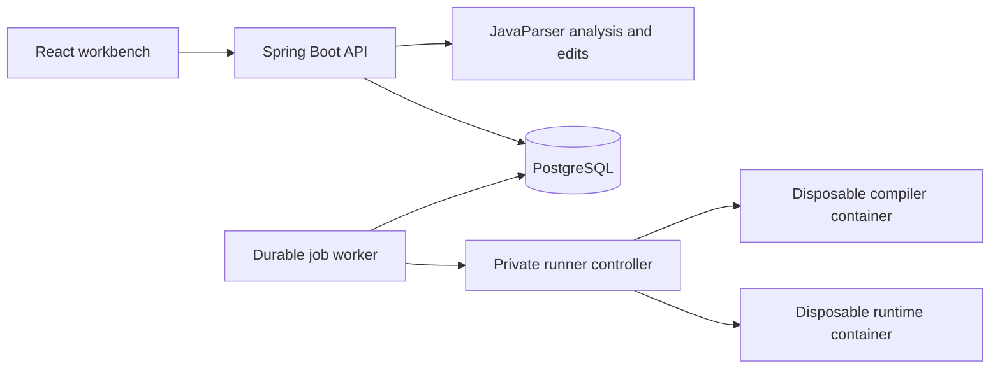

# Java Blueprints

A local Java workbench that connects source code to a structured control-flow graph and source symbol bindings. Import a program, navigate to declarations, edit expressions or statements, review the generated diff, and compile or compare immutable revisions in isolated Java containers.

## Preview

| Light | Dark |
| --- | --- |
|  |  |

## Workflow

1. Create a project, then create files and folders or import text files from a ZIP archive or directory. Review the import selection before adding it to the project.
2. Edit the source. Changes are autosaved and analyzed; **Ctrl+S** saves immediately. Selecting a graph node reveals its exact source range and supported edit fields. Place the editor cursor on a reference to inspect its binding and navigate to a declaration, including one in another project file.
   Compound conditions show the evaluation order of `&&`, `||` and `!`, including branches that skip the right operand. Select an individual test to inspect its source, or its enclosing condition to edit the whole expression.
   Traditional `switch` statements show selector evaluation, case selection, fallthrough and the destination of `break` or an enclosing loop's `continue`.
   Enhanced `for` loops show the source evaluated once, followed by element checks, binding and body repetition. Synthetic iteration steps do not expose source-edit controls.
3. Open the block palette with **+** in the dock, then drag a block onto a graph node: its upper half inserts before it, its lower half inserts after it. Empty methods accept an insertion at their entry node. Double-click an editable block to open its inspector. Edit its Java statement or supported expression, reorder statements within a block, wrap one in `if` or `while`, or add and remove a supported `else` branch. The original head stays intact while the candidate compiles.
4. Review the diff. A semantic change can be applied explicitly after compilation. A change marked as preserving behavior additionally requires a matching comparison for the exact two revisions.
5. Run the saved program and answer it in the live Console. Send additional lines while it runs, close standard input with **EOF**, or stop execution from the dock. Compare immutable revisions using a versioned test suite. Download the complete canonical snapshot or a selected file or folder as a ZIP archive.
6. Restore a historical snapshot from the history panel. Restoration creates a new revision with its source revision recorded; previous revisions remain intact. Save or discard an unsaved draft before restoring.

A saved syntax error remains a valid draft. Its analysis reports the error; an older graph is never treated as synchronized with that draft. Graph layout is stored separately from program text.

## Workspace

The graph is a permanent canvas beneath translucent panels. The dark theme uses a black canvas and flat near-black surfaces with backdrop blur; the light theme uses the same layout with light surfaces. The compact bottom dock has its own reserved row and never overlaps the tiled windows.

- Drag a panel by its six-dot handle. Nearby windows animate into the preview arrangement before you release the pointer. Drop in the center to swap windows, or near an edge to split the area. Press **Escape** to cancel. The handle also opens a keyboard-accessible move menu.
- Resize separators with the pointer or arrow keys. Hide or maximize a window from its header. The dock toggles Code, Console and Tests; **Windows** (`Окна`) restores other panels and resets the arrangement.
- Hidden windows keep their original slot and split ratios. Reopening a window retains its live editor, caret, undo history and output. Layout, visibility, active tabs and maximized state are saved separately for each project in the current browser.
- Reload restores the workspace and saved drafts. Editor view state and the graph camera are stored locally; editor undo history lasts for the current project session. Narrow screens use a panel selector while retaining the desktop layout.
- **Ctrl+K** focuses project search. The sole Run control is in the bottom dock, alongside its options and the stop action while a job is active. File, edit, view and export actions are available in the sidebar's project menu.

Workspace preferences are independent of program revisions and graph-node positions. Rearranging windows does not edit source, compile a program or create a revision. Reduced-motion preferences disable layout animation; browsers without backdrop filtering use solid panel backgrounds.

**Share** copies the local project URL. Accounts, collaborator presence and permission-based sharing are not implemented yet.

Graph nodes use distinct icons, shapes and restrained semantic colors. Connections inherit the source block's color: amber for conditions, violet for loops, red for returns, and blue for operations and calls. These colors describe the program structure; they are not a runtime execution trace. Sequential steps stay in a top-to-bottom lane; branches use separate ranks and saved manual positions remain unchanged. Conditions expose labeled true/false ports; loop regions follow the engine's ancestry. A loop outline is omitted when a manually arranged graph would visually enclose unrelated nodes. Rounded routes preserve the obstacle-aware polyline's topology and mark routes whose safe path could not be found; arbitrary diagrams are not guaranteed to be planar.

## Files and folders

The project explorer supports nested folders, empty directories, file creation, renaming and moving a file or an entire subtree. Enter a new file or folder name and press **Enter** or click elsewhere to create it; **Escape** cancels. Its icon follows the filename extension. Drag an item onto a folder, or use the move action to enter its destination. A path change does not rewrite Java packages, imports or class names; compilation reports any resulting Java errors. A mismatched public Java type offers an explicit filename correction.

Open files appear as tabs with language-specific icons and editor highlighting. Switching, closing and reopening tabs retains the current file's draft, selection and undo history during the project session. File operations save a complete snapshot together with pending text edits. Concurrent changes produce a conflict instead of replacing another saved version.

Import previews support strict UTF-8 text and ZIP archives, with selection before commit and no silent overwrite of existing paths. Archives preserve empty folders; a browser directory picker supplies files and their parent directories, but cannot enumerate empty folders. Unsupported binary files and unsafe or oversized archives are rejected. Build scripts from imported projects are never executed.

Non-Java text files can be edited and exported. Only `.java` files are analyzed and passed to the isolated Java runner. A project containing only text files or folders can be saved without scheduling a Java analysis or execution.

## Console

The Console displays standard output and errors during execution. **Send** delivers one line to the running program; **End input** (`Завершить ввод`, EOF) closes its input, allowing programs using `Scanner.hasNextLine()` or `readAllBytes()` to finish. The stop action retains captured output in the run report. Hiding the Console keeps the run active, and reloading its URL reconnects to the current job.

Interactive runs have a 120-second runtime limit, a 1 MiB combined output limit and a 1 MiB input budget including initial input. Each submitted input frame is limited to 8 KiB, with at most 1,024 frames. Compilation remains limited to 20 seconds. The elapsed time includes compilation and execution setup. Repeated input requests with the same idempotency key and body are delivered once.

The report records the immutable revision, initial input, accepted interactive input, arguments, output and termination status. Comparison tests use fixed input and independent five-second executions; they do not accept live input. A server or controller restart interrupts a live session; its process cannot be resumed.

## Test progress

The Tests panel shows compilation stages, the active case, completed and matched counts, and measured time for each case. Each case compares three independent executions of each revision. Cases run sequentially; the completion bar advances when their planned observations finish. Completion and a matching verdict are separate results.

Progress records the exact source revisions and suite version. Reloading reconnects to the same job; hiding its panel keeps verification running. Stopping retains completed case verdicts and partial observation counts, while remaining cases are marked unrun. An interrupted comparison does not publish a verification report that could authorize applying a change.

Per-case time includes all six executions and their container setup. Total time also includes compilation. The worker has a ten-minute overall job budget in addition to individual execution limits; an unfinished suite remains inconclusive. Progress is persisted under the current job attempt and lease. A restart can retain recorded progress, but cannot resume the interrupted executions.

## Code insights

The Analysis panel separates node editing, parser/coverage problems, recommendations and method metrics. Selecting a graph block opens its editor. Metrics follow the chosen method; recommendation headings navigate to their bound source location. Unsaved changes disable navigation through the older analysis.

Metrics include physical and code-token body lines, statement nodes, control nesting, loops and call sites. Nested declaration and lambda bodies are excluded from the enclosing method. The branching score is syntactic: one plus `if`, loops, conditional expressions, short-circuit operators, non-default switch groups and catch clauses. It is neither a complete CFG complexity measure nor a runtime estimate. Metric labels expose their definitions in tooltips.

Recommendations flag methods with at least 40 code-token lines, nesting of at least four control structures, nested loops, or a branching score of at least ten. They show the observed count, threshold, source location and a suggested review step. At most 400 findings are returned per analysis. These heuristics do not prove a defect, authorize a refactor or predict a speedup. Asymptotic time remains unknown until bounds and call costs can be established.

## Architecture



| Component | Location | Responsibility |
| --- | --- | --- |
| Web | `apps/web` | Configurable panel workspace, Monaco editor, React Flow graph, proposals and reports |
| API | `apps/server` | Local sessions, revision history, CAS, artifacts and durable jobs |
| Program engine | `modules/program-engine` | Parsing, source/JDK symbol resolution, graph construction and typed edits |
| Verification | `modules/verification` | Runner protocol and repeated comparison |
| Runner controller | `apps/runner-controller` | Bounded compiler/runtime containers and cleanup |
| Deployment | `infra` | Pinned base images and Compose networks |

Java source is never compiled or executed by the API JVM. Only the trusted controller receives the Docker socket. Compiler and runtime containers have no network, no host mounts, a read-only root, a non-root user, dropped capabilities and enforced resource limits.

## Requirements

- JDK 21; Maven 3.9.16 is provided through the checksum-pinned Maven Wrapper.
- Node.js 24 and pnpm 11.25.0 on `PATH`, or portable directories configured with `JB_NODE_HOME` and `JB_PNPM_HOME` in `.env`.
- Windows PowerShell 7 and a WSL2 distribution named `JavaBlueprints`, with Docker Engine and Compose installed and running inside that distribution.
- Access to Maven Central, the pnpm registry and the pinned container images on the first build.

The supplied Windows launcher uses the dedicated `JavaBlueprints` distribution. It does not change the system `PATH`, other WSL distributions or global networking settings. Caches are kept under the repository's ignored `.local` directory. On Linux, the same Maven/pnpm builds and `infra/compose.yaml` can be used with a native Docker Engine.

## Start

From the repository root:

```powershell
./scripts/start.ps1
```

The launcher creates `.env` from `.env.example` when needed, generates missing local database and controller secrets, builds Java and the frontend, starts Compose, and waits for HTTP readiness. Open **http://127.0.0.1:5174**. The terminal reports whether the isolated runner is available.

The workbench and API share one origin. PostgreSQL is bound to `127.0.0.1:55433`; the runner has no published port and is reachable only on its private control network. Stop the services while retaining database data:

```powershell
./scripts/stop.ps1
```

After a successful build, `./scripts/start.ps1 -SkipBuild` reuses the generated application artifacts and rebuilds their container images. Do not run the Vite development server and the Compose workbench on port 5174 at the same time.

To use a native API process during frontend development:

```powershell
./scripts/start-server.ps1 -Build
# In another terminal with Node/pnpm configured:
pnpm dev
```

The native API binds to `127.0.0.1:8081`. Start the database first with Compose. Native execution features remain unavailable unless a trusted Linux runner URL and token are explicitly configured; the application never falls back to host execution.

## Native Linux

With JDK 21, Node 24, pnpm 11.25.0, Docker Engine, Compose and curl installed:

```bash
bash scripts/start.sh
# Open http://127.0.0.1:5174
```

The script creates local secrets, builds from the checked-in dependency versions and starts the same Compose stack. Java and frontend checks can be run separately:

```bash
# Export the private database values for the native integration test process.
set -a; source .env; set +a
docker compose --env-file .env -f infra/compose.yaml up -d db
MAVEN_USER_HOME="$PWD/.local/cache/maven-wrapper" bash ./mvnw -B -ntp test
pnpm typecheck && pnpm test:web && pnpm build
```

The Windows launcher and test command are verified in the prepared Windows/WSL environment. The native Linux launcher uses the same build and Compose commands; a separate clean Linux-host run has not yet been validated.

## Checks

```powershell
./scripts/test.ps1
pnpm typecheck
pnpm test:web
pnpm build
```

The Java command runs parser/graph/edit tests, semantic binding tests, comparison tests and real PostgreSQL HTTP integration tests. Each backend integration run creates its own randomly named schema and removes that schema afterward. It checks lexical scope and shadowing, bounded overload resolution, source/JDK targets, analysis environment invalidation, structural edit anchors and source preservation, concurrent head updates, idempotent restoration and replay, immutable storage, invalid drafts, strict import normalization, original artifact bytes, ZIP export content, scoped IDs, CSRF/origin checks, layout bindings and fenced job publication.

Docker execution integration tests are opt-in through `JB_RUNNER_INTEGRATION=true` and require a Linux controller. A Windows API/client can call that controller over authenticated HTTP; the controller's Docker subprocesses must run on Linux. Tests cover actual compilation, exact UTF-8 streams, three observations per side, intentional mismatches, compilation errors, timeout, output limits, cancellation and sandbox boundaries. Ordinary `test.ps1` does not claim to run those opt-in checks. See [the runner integration commands](infra/runner/README.md#repeat-the-execution-integration-checks) for the complete controller setup and invocation.

To repeat the browser checks, start the complete stack first, then install Chromium and run Playwright:

```powershell
$env:PLAYWRIGHT_BROWSERS_PATH="$PWD/.local/cache/playwright"
pnpm --filter @java-blueprints/web exec playwright install chromium
pnpm --filter @java-blueprints/web exec playwright test
```

These browser tests create synthetic projects in the local database. They exercise session recovery, concurrent edits, source bindings, declaration navigation across files, stale semantic bindings, invalid drafts, responsive light/dark layouts, structural insert/delete proposals, historical restoration and actual candidate verification.

Workspace checks cover drag-and-drop arrangements, tab groups, resizing, local preference recovery and preservation of editor and graph state. Pure frontend tests validate layout-tree invariants and graph presentation geometry. UI layout actions must not create source revisions, proposals, jobs or graph-layout writes.

## Data and API

The API lives under `/api/v1`. `GET /session` establishes a local cookie and returns a session-bound CSRF token. Mutations require the token and an idempotency UUID. Head mutations also require `If-Match` with the current revision UUID, or `empty` for a project without a head. A concurrent change returns a conflict instead of overwriting another save.

Revisions retain canonical UTF-8 text with LF line endings, directory entries and a SHA-256 tree hash. The separate bundle hash covers the Java subset and is absent when there are no Java sources. Imports also retain original bytes and normalization metadata. Analyses carry their own version and source-map identity; node IDs are valid only in that analysis. Candidates, suites and reports retain their exact input references. Artifacts are retrieved by project-scoped IDs rather than host paths.

Graph nodes advertise `allowedOperations` and `insertionPositions`. The change endpoint accepts `replace_expression`, `replace_statement`, `insert_statement`, `delete_statement`, `move_statement`, `wrap_if`, `wrap_while`, `add_else` and `remove_else` with operation-specific payloads. Insertions and structural edits use bound statements or method entries, never client-supplied source offsets. Compilation validates the complete candidate before it becomes applicable. `POST /projects/{p}/revisions/{r}/restore` creates a new revision with `sourceRevisionId`, checks the current head, and starts a fresh analysis. Restoration does not inherit a previous revision's verification result.

Analyses include a `semantics` model with analysis-scoped symbols and references, plus a `symbolEnvironmentHash` identifying the resolver configuration and JDK runtime. Source targets carry declaration-name ranges; JDK targets carry external keys without fabricated source locations. Each reference records an exact compile-time target, bounded candidates, or an unresolved reason. Virtual calls do not claim a unique runtime target. Updating the engine or resolver environment requires a fresh analysis for new edits; historical analysis and accepted idempotent responses remain readable.

Graph nodes carry an `executionRole` that distinguishes statements and condition tests from structural anchors, source expression projections and synthetic flow nodes. Short-circuit tests have source ranges but do not add edit operations. Enclosing condition anchors retain their existing edit controls. Older analyses without this field retain an unknown role.

A comparison means **matched on the recorded tests**, not a proof of equivalence. It requires a nonempty suite, complete observations and stable exact stdout/stderr/exit results. Equal timeouts, OOM, truncated output, cancellation or unavailable execution never count as a match. A standalone run does not satisfy the verification gate for a behavior-preserving change.

## Fixed execution limits

The initial `java21-v1` execution profile is immutable rather than configurable through environment variables:

| Limit | Value |
| --- | --- |
| Project tree | 100 entries including directories, 1 MiB UTF-8 text |
| ZIP import | 1 MiB compressed input and 1 MiB total expanded content |
| Console input | 1 MiB |
| Arguments | 100, 8 KiB each, 64 KiB combined UTF-8; no NUL |
| Test suite | 100 cases; three independent runs per version and case |
| Sandbox | 512 MiB RAM, 1 CPU, 128 PIDs |
| Compilation / runtime | 20 seconds / 5 seconds per execution |
| Combined stdout and stderr | 1 MiB per execution |
| Controller retention | 1024 handles, 64 MiB aggregate, ten minutes |
| Backend job deadline | Ten minutes; incomplete work cannot verify preservation |

Java source paths and case identifiers follow the shared runner policy. Java paths use relative ASCII Java identifiers, with `package-info.java` and `module-info.java` also accepted. Other text paths may contain Unicode and spaces; all paths must be relative and cannot contain traversal components. A test case's separate display name may contain Unicode.

## Current scope

The implemented slice supports source import/save/history/restore, JavaParser-backed method graphs, source navigation, typed expression/condition replacement and statement insertion/deletion, separate layout persistence, detached proposals with diff and explicit apply, console runs, versioned console suites, repeated comparison and source export.

Structural edits are limited to supported methods and actual block statement lists. Reordering moves one statement before or after a sibling in the same block. Wrapping creates a braced `if` or `while` around one statement; a new loop cannot capture an existing outer `break` or `continue`. Adding `else` requires a braced `then` branch and a braced new body; removing `else` requires braced branches and a comment-free removal span. The inspector exposes only the operations available for the selected node.

These are explicit semantic edits: changed order or repetition can change program behavior. Compilation checks types, scope, definite assignment and reachability before apply; preservation still requires a matching recorded comparison. Internal comments move with the statement, while comments outside its token span remain at their original positions. Deletions cannot discard comments. Opaque constructs and expression fragments are not structural edit anchors. Cross-block moves, multi-statement wrapping and a general structural undo/redo stack remain outside this scope; historical restoration is explicit.

Condition flow covers normal completion of `&&`, `||`, `!` and parentheses in supported `if`, `while`, `do` and `for` conditions. Other expression subtrees remain atomic tests; calls, eager operators, ternaries and unboxing are not expanded into a complete expression or exception graph. Loop initialization, updates and unlabeled jump targets remain explicit. A method exceeding 4096 condition tests is preserved as opaque with a diagnostic.

Traditional colon-style `switch` statements evaluate the selector once and dispatch to a case or default, with explicit fallthrough and unlabeled jump targets. Selector and case nodes support source navigation; separate expression projections retain their existing edit controls. Case-label type and constant validity are checked by the isolated compiler. Direct case statement lists do not become insertion or deletion anchors; actual nested blocks retain those operations. The method-wide limits are 1024 switch entries and 4096 labels. Arrow rules, switch expressions, patterns, `case null`, labeled jumps and `try`/`finally` remain outside this control-flow subset and preserve the method as opaque. Implicit selector exceptions are not expanded into a complete exception graph.

Enhanced `for` uses a normal iteration abstraction for arrays and `Iterable`: a source expression is evaluated once, then synthetic check, element-binding and continuation steps surround the body. This does not expand the distinct array and iterator protocols, conversions or exceptional paths into individual Java operations. `break` and `continue` retain their enclosing-loop targets, including through nested switches. Existing expression projections support changing the source through the compile-gated proposal workflow; synthetic steps are read-only and have no invented source range. Methods exceeding 1024 enhanced loops are preserved as opaque with a diagnostic.

The graph/edit support matrix is intentionally conservative: unsupported constructs remain visible as limitations and are preserved in source. Symbol resolution covers a bounded subset of source classes/interfaces, fields, parameters, local variables, methods, constructors and platform JDK references. It uses only the in-memory source bundle and the platform classloader; application dependencies and filesystem classpaths are not searched. Local/anonymous classes, lambdas, unsupported type domains and unresolved dependencies can produce partial results. Overload inference is bounded, and access-control, alias, escape, effect and dominance proofs are not provided. Analysis budgets can reject oversized or deeply nested ASTs while retaining the source.

Complexity remains unknown. General symbol renaming, structural extraction, class decomposition, automatic optimization, method harnesses and benchmarking are not implemented. A resolved reference does not establish that a program compiles or preserves behavior. External build dependencies are not imported; the runner compiles a bounded Java 21 source bundle against its fixed JDK.

This deployment is a single-user local prototype. It has local session/CSRF controls, not public multi-tenant authentication. The runner controller is a singleton; its execution handles are bounded and temporary, while completed reports and artifacts are persisted by the API. Controller restart makes in-flight handles unavailable. Full mandatory-language coverage, public deployment hardening and broad performance claims require further validation.
