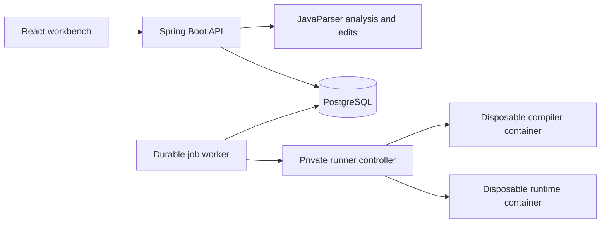

# Java Blueprints

A local Java workbench that connects source code to a structured control-flow graph and source symbol bindings. Import a program, navigate to declarations, edit expressions or statements, review the generated diff, and compile or compare immutable revisions in isolated Java containers.

## Preview

| Light | Dark |
| --- | --- |
|  |  |

## Workflow

1. Create a project and import one or more `.java` files, then edit the imported source in the editor.
2. Save and analyze the revision. Selecting a graph node reveals its exact source range and supported edit fields. Place the editor cursor on a reference to inspect its binding and navigate to a declaration, including one in another project file.
   Compound conditions show the evaluation order of `&&`, `||` and `!`, including branches that skip the right operand. Select an individual test to inspect its source, or its enclosing condition to edit the whole expression.
   Traditional `switch` statements show selector evaluation, case selection, fallthrough and the destination of `break` or an enclosing loop's `continue`.
3. Change an expression or condition, insert a statement, or delete a supported statement from the graph. Empty methods accept an insertion at their entry node. Condition and loop templates provide editable starting points. The original head stays intact while the candidate compiles.
4. Review the diff. A semantic change can be applied explicitly after compilation. A change marked as preserving behavior additionally requires a matching comparison for the exact two revisions.
5. Run a single console input, or compare a versioned test suite. Download the selected canonical Java snapshot as a ZIP archive.
6. Restore a historical snapshot from the history panel. Restoration creates a new revision with its source revision recorded; previous revisions remain intact. Save or discard an unsaved draft before restoring.

A saved syntax error remains a valid draft. Its analysis reports the error; an older graph is never treated as synchronized with that draft. Graph layout is stored separately from program text.

## Architecture



| Component | Location | Responsibility |
| --- | --- | --- |
| Web | `apps/web` | Monaco editor, React Flow graph, proposals and reports |
| API | `apps/server` | Local sessions, revision history, CAS, artifacts and durable jobs |
| Program engine | `modules/program-engine` | Parsing, source/JDK symbol resolution, graph construction and typed edits |
| Verification | `modules/verification` | Runner protocol and repeated comparison |
| Runner controller | `apps/runner-controller` | Bounded compiler/runtime containers and cleanup |
| Deployment | `infra` | Pinned base images and Compose networks |

Java source is never compiled or executed by the API JVM. Only the trusted controller receives the Docker socket. Compiler and runtime containers have no network, no host mounts, a read-only root, a non-root user, dropped capabilities and enforced resource limits.

## Requirements

- JDK 21; Maven 3.9.16 is provided through the checksum-pinned Maven Wrapper.
- Node.js 24 and pnpm 11.25.0 on `PATH`, or portable directories configured with `JB_NODE_HOME` and `JB_PNPM_HOME` in `.env`.
- Windows PowerShell 7 and a WSL2 distribution named `JavaBlueprints`, with Docker Engine and Compose installed and running inside that distribution.
- Access to Maven Central, the pnpm registry and the pinned container images on the first build.

The supplied Windows launcher uses the dedicated `JavaBlueprints` distribution. It does not change the system `PATH`, other WSL distributions or global networking settings. Caches are kept under the repository's ignored `.local` directory. On Linux, the same Maven/pnpm builds and `infra/compose.yaml` can be used with a native Docker Engine.

## Start

From the repository root:

```powershell
./scripts/start.ps1
```

The launcher creates `.env` from `.env.example` when needed, generates missing local database and controller secrets, builds Java and the frontend, starts Compose, and waits for HTTP readiness. Open **http://127.0.0.1:5174**. The terminal reports whether the isolated runner is available.

The workbench and API share one origin. PostgreSQL is bound to `127.0.0.1:55433`; the runner has no published port and is reachable only on its private control network. Stop the services while retaining database data:

```powershell
./scripts/stop.ps1
```

After a successful build, `./scripts/start.ps1 -SkipBuild` reuses the generated application artifacts and rebuilds their container images. Do not run the Vite development server and the Compose workbench on port 5174 at the same time.

To use a native API process during frontend development:

```powershell
./scripts/start-server.ps1 -Build
# In another terminal with Node/pnpm configured:
pnpm dev
```

The native API binds to `127.0.0.1:8081`. Start the database first with Compose. Native execution features remain unavailable unless a trusted Linux runner URL and token are explicitly configured; the application never falls back to host execution.

## Native Linux

With JDK 21, Node 24, pnpm 11.25.0, Docker Engine, Compose and curl installed:

```bash
bash scripts/start.sh
# Open http://127.0.0.1:5174
```

The script creates local secrets, builds from the checked-in dependency versions and starts the same Compose stack. Java and frontend checks can be run separately:

```bash
# Export the private database values for the native integration test process.
set -a; source .env; set +a
docker compose --env-file .env -f infra/compose.yaml up -d db
MAVEN_USER_HOME="$PWD/.local/cache/maven-wrapper" bash ./mvnw -B -ntp test
pnpm typecheck && pnpm test:web && pnpm build
```

The Windows launcher and test command are verified in the prepared Windows/WSL environment. The native Linux launcher uses the same build and Compose commands; a separate clean Linux-host run has not yet been validated.

## Checks

```powershell
./scripts/test.ps1
pnpm typecheck
pnpm test:web
pnpm build
```

The Java command runs parser/graph/edit tests, semantic binding tests, comparison tests and real PostgreSQL HTTP integration tests. Each backend integration run creates its own randomly named schema and removes that schema afterward. It checks lexical scope and shadowing, bounded overload resolution, source/JDK targets, analysis environment invalidation, structural edit anchors and source preservation, concurrent head updates, idempotent restoration and replay, immutable storage, invalid drafts, strict import normalization, original artifact bytes, ZIP export content, scoped IDs, CSRF/origin checks, layout bindings and fenced job publication.

Docker execution integration tests are opt-in through `JB_RUNNER_INTEGRATION=true` and require a Linux controller. A Windows API/client can call that controller over authenticated HTTP; the controller's Docker subprocesses must run on Linux. Tests cover actual compilation, exact UTF-8 streams, three observations per side, intentional mismatches, compilation errors, timeout, output limits, cancellation and sandbox boundaries. Ordinary `test.ps1` does not claim to run those opt-in checks. See [the runner integration commands](infra/runner/README.md#repeat-the-execution-integration-checks) for the complete controller setup and invocation.

To repeat the browser checks, start the complete stack first, then install Chromium and run Playwright:

```powershell
$env:PLAYWRIGHT_BROWSERS_PATH="$PWD/.local/cache/playwright"
pnpm --filter @java-blueprints/web exec playwright install chromium
pnpm --filter @java-blueprints/web exec playwright test
```

These browser tests create synthetic projects in the local database. They exercise session recovery, concurrent edits, source bindings, declaration navigation across files, stale semantic bindings, invalid drafts, responsive light/dark layouts, structural insert/delete proposals, historical restoration and actual candidate verification.

## Data and API

The API lives under `/api/v1`. `GET /session` establishes a local cookie and returns a session-bound CSRF token. Mutations require the token and an idempotency UUID. Head mutations also require `If-Match` with the current revision UUID, or `empty` for a project without a head. A concurrent change returns a conflict instead of overwriting another save.

Revisions retain canonical UTF-8 source with LF line endings and a SHA-256 bundle hash. Imports also retain original bytes and normalization metadata. Analyses carry their own version and source-map identity; node IDs are valid only in that analysis. Candidates, suites and reports retain their exact input references. Artifacts are retrieved by project-scoped IDs rather than host paths.

Graph nodes advertise `allowedOperations` and `insertionPositions`. The change endpoint accepts `replace_expression`, `insert_statement` and `delete_statement` with operation-specific payloads. Insertions use a bound statement or method entry, never a client-supplied source offset. Compilation validates the complete candidate before it becomes applicable. `POST /projects/{p}/revisions/{r}/restore` creates a new revision with `sourceRevisionId`, checks the current head, and starts a fresh analysis. Restoration does not inherit a previous revision's verification result.

Analyses include a `semantics` model with analysis-scoped symbols and references, plus a `symbolEnvironmentHash` identifying the resolver configuration and JDK runtime. Source targets carry declaration-name ranges; JDK targets carry external keys without fabricated source locations. Each reference records an exact compile-time target, bounded candidates, or an unresolved reason. Virtual calls do not claim a unique runtime target. Updating the engine or resolver environment requires a fresh analysis for new edits; historical analysis and accepted idempotent responses remain readable.

Graph nodes carry an `executionRole` that distinguishes statements and condition tests from structural anchors, source expression projections and synthetic flow nodes. Short-circuit tests have source ranges but do not add edit operations. Enclosing condition anchors retain their existing edit controls. Older analyses without this field retain an unknown role.

A comparison means **matched on the recorded tests**, not a proof of equivalence. It requires a nonempty suite, complete observations and stable exact stdout/stderr/exit results. Equal timeouts, OOM, truncated output, cancellation or unavailable execution never count as a match. A standalone run does not satisfy the verification gate for a behavior-preserving change.

## Fixed execution limits

The initial `java21-v1` execution profile is immutable rather than configurable through environment variables:

| Limit | Value |
| --- | --- |
| Source bundle | 100 files, 1 MiB canonical UTF-8 |
| Console input | 1 MiB |
| Arguments | 100, 8 KiB each, 64 KiB combined UTF-8; no NUL |
| Test suite | 100 cases; three independent runs per version and case |
| Sandbox | 512 MiB RAM, 1 CPU, 128 PIDs |
| Compilation / runtime | 20 seconds / 5 seconds per execution |
| Combined stdout and stderr | 1 MiB per execution |
| Controller retention | 1024 handles, 64 MiB aggregate, ten minutes |
| Backend job deadline | Ten minutes; incomplete work cannot verify preservation |

Source file and case identifiers follow the shared runner policy. Source paths use relative ASCII Java identifiers, with `package-info.java` and `module-info.java` also accepted; a test case's separate display name may contain Unicode.

## Current scope

The implemented slice supports source import/save/history/restore, JavaParser-backed method graphs, source navigation, typed expression/condition replacement and statement insertion/deletion, separate layout persistence, detached proposals with diff and explicit apply, console runs, versioned console suites, repeated comparison and source export.

Structural edits are limited to supported methods and actual block statement lists. A statement with internal comments cannot be deleted through the graph; adjacent comments and untouched source are retained. Opaque constructs and expression fragments are not structural edit anchors. Historical restoration is explicit; a general undo/redo stack and statement wrapping or reordering are not implemented.

Condition flow covers normal completion of `&&`, `||`, `!` and parentheses in supported `if`, `while`, `do` and `for` conditions. Other expression subtrees remain atomic tests; calls, eager operators, ternaries and unboxing are not expanded into a complete expression or exception graph. Loop initialization, updates and unlabeled jump targets remain explicit. A method exceeding 4096 condition tests is preserved as opaque with a diagnostic.

Traditional colon-style `switch` statements evaluate the selector once and dispatch to a case or default, with explicit fallthrough and unlabeled jump targets. Selector and case nodes support source navigation; separate expression projections retain their existing edit controls. Case-label type and constant validity are checked by the isolated compiler. Direct case statement lists do not become insertion or deletion anchors; actual nested blocks retain those operations. The method-wide limits are 1024 switch entries and 4096 labels. Arrow rules, switch expressions, patterns, `case null`, labeled jumps and `try`/`finally` remain outside this control-flow subset and preserve the method as opaque. Implicit selector exceptions are not expanded into a complete exception graph.

The graph/edit support matrix is intentionally conservative: unsupported constructs remain visible as limitations and are preserved in source. Symbol resolution covers a bounded subset of source classes/interfaces, fields, parameters, local variables, methods, constructors and platform JDK references. It uses only the in-memory source bundle and the platform classloader; application dependencies and filesystem classpaths are not searched. Local/anonymous classes, lambdas, unsupported type domains and unresolved dependencies can produce partial results. Overload inference is bounded, and access-control, alias, escape, effect and dominance proofs are not provided. Analysis budgets can reject oversized or deeply nested ASTs while retaining the source.

Complexity remains unknown. General symbol renaming, structural extraction, class decomposition, automatic optimization, method harnesses and benchmarking are not implemented. A resolved reference does not establish that a program compiles or preserves behavior. External build dependencies are not imported; the runner compiles a bounded Java 21 source bundle against its fixed JDK.

This deployment is a single-user local prototype. It has local session/CSRF controls, not public multi-tenant authentication. The runner controller is a singleton; its execution handles are bounded and temporary, while completed reports and artifacts are persisted by the API. Controller restart makes in-flight handles unavailable. Full mandatory-language coverage, public deployment hardening and broad performance claims require further validation.
